# Introduction

## About the product

DocCollect is a module inside Spectrum Cloud, made for CA firms and tax practitioners. It helps a firm collect documents from its clients on WhatsApp, review what the clients send, and keep the approved files in one organised place.

Today most firms ask for documents in personal WhatsApp chats and keep track in Excel. Nobody can say at a glance who has sent what. Files get lost in chats, the same reminder is typed again and again, and approved files have no proper home. DocCollect replaces this.

**For every request, the product answers four questions:**

| # | Question |
|---|---|
| 1 | Which documents have we asked this client for? |
| 2 | What has the client sent so far? |
| 3 | What is waiting for the firm, what is approved, and what was sent back? |
| 4 | Where is the approved file kept? |

Every firm uses its own WhatsApp number, which it connects once. The product does not use a shared number.

## What the product does

| Area | What the firm can do |
|---|---|
| **Ask** | Make a request: one checklist sent to one or more clients, with a last date. Every client gets their own WhatsApp message and their own upload link. Some documents can be marked optional, so a client can skip them. |
| **Receive** | Collect files from the WhatsApp chat and from the upload link. A file is read and placed on the right client and document when the match is sure. A file from a number the firm has not saved is also taken, and waits in Unassigned for the firm to place. |
| **Review** | Approve each file and choose where to keep it, or send it back with a reason. The client gets a message with the upload link. |
| **Follow up** | See which client still owes which document, and remind one client or many with a single click. Send a new upload link when one is lost. |
| **Keep** | Store approved files in Document Master, in folders for each client, registration and year. See in the Tracker who has sent what, and export it to Excel. |
| **Set up** | Keep a list of documents and saved checklists, and set up the firm's profile, upload link period and team list. |

## Who uses the product

| User | What they do |
|---|---|
| **Owner** | The firm's partner. Connects the firm's WhatsApp number, sets up the firm, makes requests, and reviews and approves files. |
| **Admin and Staff** | Make requests, remind clients, and review and approve files. |
| **Client** | Has no login. The client receives WhatsApp messages, and sends files in the chat or through the upload link. |

There is no role-based access in this version: everyone on the team can do everything. The roles are only shown in Settings, under **Team**.

The product is designed for laptop and desktop screens.

## How this document is organised

This document first explains how the product works, and then describes each screen: what it is for, what the user sees, what the user can do, and the rules the product keeps. It is written for business people, designers and developers alike. Screenshots show the screens. Words in **bold** are the names that appear on the screen.

| Chapter | What it covers |
|---|---|
| **Plans and Pricing** | How the user opens DocCollect from Spectrum Cloud, and how the product is sold |
| **How the Product Works** | The whole journey of a request, the building blocks, and the states. Read this first. |
| **How Files Are Read and Mapped** | What the product must do with every file that arrives: map it to a client, a request and a document, and when the firm decides |
| **How Screens Behave** | Things that work the same on every screen: statuses, filters, search, sorting, pages, dialogs and messages |
| **Connect Your WhatsApp** | Connecting the firm's number, and what the product does while it is not ready |
| **Dashboard, Clients, New Request, Requests, Inbox, Document Master, Documents and Checklists, Message Templates, Settings** | The screens, in the order of the left menu |
| **Client Upload Page** | What the client sees and does |
| **Navigation and Search** | The frame around every screen: the left menu, the top bar, search, the bell and the account menu |

## Related documents

| Document | What it holds |
|---|---|
| **Message templates** | The exact wording of the 7 WhatsApp messages and when each goes out. It is an Excel file, *Message-Templates.xlsx*, shared with this document. |
| **Technical document** | Hosting, data, security, how the modules connect, and how files are read. |
| **Prototype** | A working prototype that shows the screens described here, with sample data. It is for reference only. |

# Plans and Pricing

## How the user opens DocCollect

The user opens **Spectrum Cloud** and goes to the **Office Management** module.

- One new **card**, named **DocCollect**, is added in the Office Management module.
- Clicking the card opens DocCollect in the same tab, on the Dashboard.
- The user is already signed in, because they came from Spectrum Cloud, so DocCollect has no login of its own.

The first time, the firm has not connected WhatsApp, so the Dashboard opens with a yellow banner: "Connect your WhatsApp to start sending requests and reminders." When the user signs out from the account menu, DocCollect shows a page that says "You have signed out".

## Product plans

> **NOTE** TBD @Priya Ma'am. The plans and their pricing will be decided and added by the business.

## Message pricing

> **NOTE** TBD @Priya Ma'am. The pricing of WhatsApp messages will be decided and added by the business.

# How the Product Works

## The journey in one line

The firm connects its WhatsApp, makes a request, clients send documents, the firm reviews each file, and the approved files are kept in Document Master.

| Step | What happens |
|---|---|
| **1. Open** | The user clicks the DocCollect card in Spectrum Cloud and lands on the Dashboard. |
| **2. Connect** | The firm connects its own WhatsApp number through Ramwin. Until then the app works, but nothing can be sent. |
| **3. Set up** | The firm checks its documents and checklists. The clients come from KDK. |
| **4. Ask** | The firm makes a request: a checklist, the registrations, a last date. One WhatsApp message goes to each client. |
| **5. Answer** | The client sends files in the chat, or opens the upload link and uploads. No login is needed. |
| **6. Review** | Each file arrives as **To review**. The firm approves it and chooses a folder, or sends it back with a reason. |
| **7. Chase** | Clients who have not answered are reminded with one click. A lost link is replaced with a new one. When all required documents arrive, and again when all are approved, the client gets a message by itself. |
| **8. Keep** | Approved files sit in Document Master, and the Tracker shows who has sent what. |

## The messages the client gets

DocCollect sends only these 7 messages, all from the firm's own WhatsApp number. The firm cannot change their words. The exact text is in the Excel file listed under Related documents.

| Message | When it goes | How |
|---|---|---|
| **Document request** | The firm sends a new request. | The firm presses **Send**. |
| **Gentle reminder** | A required document is still missing. It says how many documents have come, and lists what is pending. | The firm presses **Remind**. |
| **All documents received** | The last required document of the client has arrived. The firm is now reviewing. | By itself. The firm can also press **Send update**. |
| **All documents approved** | The firm has approved the last required document of the client. | By itself. The firm can also press **Send update**. |
| **Document rejected** | The firm sends a document back, with the reason. | The firm presses **Reject**. |
| **Optional document rejected** | The firm sends back a document that is optional. | The firm presses **Reject**. |
| **Fresh upload link** | The firm sends a new link. | The firm presses **Send a new link**. |

- Only required documents count for the two messages that go by themselves. An optional document never starts them.
- Each of the two goes once for a client in a request.
- Approving any other document sends nothing.
- At present there are 7 messages. More can be added later.
- When the firm connects its WhatsApp and the channel id is received, all the templates are sent to WhatsApp for approval by themselves. The firm does nothing for it.
- When WhatsApp is not connected, or a message is not approved, that message does not go. For the two that go by themselves, the Approve window says so beforehand.

## The building blocks

A **client** is one PAN: a person or a business. All clients come from KDK.

- A client has **registrations**: the PAN for Income tax (shown as ITR), every GSTIN and every TAN.
- A firm with two GSTINs is one client with two GST registrations.
- Every registration has one **contact**, the person who gets the messages.
- A second GSTIN often has its own person at that branch.
- One contact can look after several registrations, and even several clients, for example a father filing for his two daughters.

A **document** is a kind of paper the firm asks for, such as PAN card. The firm keeps a list of them.

- Each document has three settings, all off at first.
- **Client can send many files** suits papers like Aadhaar, with its front and back.
- **Optional** lets the client skip the document: it never holds a request back, it is not counted in progress, and nobody is reminded for it.
- **Send only one time** suits papers like PAN card: they are kept in the client's Permanent folder and are not asked again next year.

Every request asks for every document again. A document a client sent in an earlier year is not reused, except documents set as **Send only one time**, which are not asked again.

A **checklist** is a saved list of documents for one job. It is always used for Income tax, GST or TDS.

- A **request** is one checklist sent to one or more registrations of the same kind, with one last date.
- It has a number such as **R-1050**.
- Each registration in the request is a **request line**, with its own message, its own link and its own number such as **R-1050-03**.
- A **file** is what the client actually sends.
- A **template** is a fixed WhatsApp message that WhatsApp has approved; the firm cannot change its words.

## The states of a document and a request

A document in a request is **Pending**, **To review**, **Approved**, **Rejected** or **Not applicable**. One client in a request is **To review**, **Waiting**, **Overdue** or **Complete**.

- A whole request is **To review** when some file waits for the firm, **Waiting** when it waits for clients, and **Completed** when every mandatory document of every client is approved.
- Optional documents never hold a request back.

## When the firm can send

A message goes out only when the firm's own WhatsApp is connected and WhatsApp has approved that message. The product has four situations.

| Situation | What the user sees | What happens on Send |
|---|---|---|
| **Not connected** | A banner: "Connect your WhatsApp to start sending requests and reminders." | A dialog opens. Nothing is sent. |
| **Waiting for approval** | A banner that says the number is connected and WhatsApp is still approving the messages. | A dialog opens. Nothing is sent. |
| **Disconnected** | A banner: "Your WhatsApp got disconnected." This happens when WhatsApp logs the number out. | A dialog opens. Nothing is sent. |
| **Ready** | No banner. | The message goes. |

Even when the firm is ready, one message whose template is not approved yet is blocked on its own, and the others still go. The firm sees such a message only as "waiting for approval".

- The firm never sees which messages WhatsApp turned down, or why.
- Clients, documents, checklists, the Inbox, reviewing files and Document Master keep working in every situation.
- Only sending is blocked.

> **NOTE** Whether a message can be sent is decided by Meta's WhatsApp guidelines. The product sends a message whenever it is allowed. When a guideline puts a limit, for example the 24-hour window after the client's last message, the product follows that limit.

## A worked example

The names, dates and numbers below are only for example.

Kartik's firm opens DocCollect from Spectrum Cloud and sees a banner that WhatsApp is not connected. The firm connects its number on Ramwin's page.

- The banner says the number is waiting for approval, and a little later it goes.
- The firm makes a request with the checklist **ITR salaried** for Ramesh Kumar, with a last date of 5 October, and switches the LIC premium receipts to **Optional**.

Ramesh gets one WhatsApp message with the list and a link. He sends his Form 16 in the chat and uploads the rest through the link.

- The Dashboard shows him under **To review**.
- The firm opens his documents, approves five, and sends the bank statement back as "Blurry or unreadable".
- Ramesh gets a message with the upload link, uploads the statement again, and the firm approves it.
- The request is now **Completed**, even though the optional LIC receipts never came.
- Every approved file is in Ramesh's folder in Document Master, under his PAN and the year, and his PAN card is in his Permanent folder.

# How Files Are Read and Mapped

## Purpose

Every file that arrives, from the WhatsApp chat or from the upload link, must be read and then mapped to the flow described in this document: to a client, to a request, and to a document in that request.

- How a file is read is the developers' work and is described in the technical document.
- This chapter says what the product must do with the result.
- One idea sits behind all of it: **the file decides, the number only helps, and the firm always has the last word.**

## The requirement

**Wherever a file comes from, the system must read it, map it to the flow in this document, and the user must review it.**

| Where the file comes from | What the system must do |
|---|---|
| The WhatsApp chat, from a number the firm has saved | Read the file, find the client, the request and the document, and put the file on that document as **To review** when the match is sure. If it is not sure, suggest a place. |
| The WhatsApp chat, from a number the firm has not saved | Read the file and guess the client from what is written on it. Keep it in **Unassigned**, with the guess shown. |
| The upload link | The file is already tied to a request line and a document. Read it too, and warn the user when it looks like another client's file or another kind of document. |
| Many files at once, or files of any kind (PDF, photo, Excel, Word, ZIP) | Handle every file on its own, so each has its own card. A file that cannot be read waits for the user. |

The system must read: the kind of document, the name on it, the PAN, GSTIN or TAN, the account number and the year. It must show what it read next to the file, and how sure it is: **sure**, **not sure**, or **could not tell**. The user always reviews. The user can accept, change or remove what the system did. How the files are read, and how the system is trained, is in the technical document.

## What the product must work out

For every file the product works out three things. The first is whose file it is: the client, and the registration.

- The second is which request it belongs to.
- The third is which document in that request it is.
- To do this it reads what is on the file, which means the kind of document, the name, the PAN, GSTIN or TAN, the account number and the year, and it looks at the chat the file came in and the number it came from.
- The number is only a hint, because one phone can belong to several clients, for example a father who files for his two daughters.
- What is written on the file decides which client it is.

## A file from the upload link

A file that the client uploads through the link is already tied to a request line and to the document the client chose. Nothing needs to be worked out. It goes on that document as **To review**, and the firm decides.

## A file from the chat

A file that arrives in the chat is mapped in this order. First the product finds the client, by the PAN, GSTIN or TAN on the file, and if that is not there, by the name.

- Then it looks at the open requests of that client.
- If exactly one pending document in one request fits the file, the file belongs there.
- If the file could fit more than one place, for example two open requests that both ask for a bank statement, the product does not choose.
- It suggests, and the firm picks the request and then the document.
- The product never asks the client which request a file belongs to.
- If the document allows many files, a new file is added to it as one more file.
- If it allows one file, the new file takes the place of the old one.

A file is put on a document by the product only when the client, the request and the document are all sure. Even then it is only **To review**, and the firm still approves it. Anything less than sure is a suggestion, and nothing is filed until the firm chooses.

## What happens in each case

| Case | What the product does |
|---|---|
| The client is known, a request is open, and the file fits one pending document by its number | The file is put on that document by itself, as **To review**. The firm still approves it. |
| The same, but only the name matched, or the file fits more than one place | The chat shows "Looks like <document>" with **Place it** and **Not this**. Nothing is filed until the firm says so. |
| The client is known, but no request is open | The file waits as **Not placed yet**. The firm adds it to a request or saves it in a folder. |
| The file comes from a number the firm has not saved, and the client can be guessed from the file | The file goes to **Unassigned**, with the guess shown. It is never filed by itself, because the number is not proven. |
| The file comes from an unknown number and nothing could be read | The file goes to **Unassigned** and says that we could not tell whose file it is. The firm saves it in a folder, or saves the number as a contact first. |
| The number belongs to several clients, or several requests are open | The request list names the client in each title. The firm picks the request, then the document. |
| The AI put the file on the wrong document | The firm moves it to another document, or takes it off the checklist. |
| The file looks like another client's | An amber line warns the firm before the file is added. |
| The same document is sent twice | A line says it may be a duplicate. A second file for a document that allows many files is added as another file. |
| The file is not a document, for example a photo | It is skipped, with a note in the chat. Nothing is saved. |

## What must never happen

A file from an unknown number must never be filed by itself. A file must never be approved without the firm. The client must never be asked which request a file belongs to. And a file must never be lost: if the product cannot map it, it waits for the firm.

# How Screens Behave

## Statuses and dots

The same words and marks are used on every screen. A document is **Pending**, **To review**, **Approved**, **Rejected** or **Not applicable**. In grids such as the Tracker, a green tick means the file is here and approved, orange means it is waiting for review, an empty circle means we are waiting for the client, a red cross means the file was sent back, a dashed circle means the document is optional and not yet sent, and a dash means the client was not asked.

## Filters, search, sorting and pages

Lists in DocCollect work the same way on every screen. A **filter** is a box above the list that shows its name and the choice made, for example "Last date  Any".

- A click opens the choices under the box, and choosing one closes it and changes the list at once.
- A filter that is set to something other than "Any" or "All" looks highlighted, so the user can see that the list is narrowed.
- Filters and the **search box** work together: a row shows only if it passes every filter and the search.
- Typing in a search box narrows the list as the user types, without pressing Enter.

Some lists can be **sorted**. A click on a column heading sorts the list by that column, and a second click reverses it. When the user changes a filter, a search or a sort, the list goes back to its first page. When nothing matches, the list says so in plain words.

Long lists are **paged**. The bottom of the list says "Showing 1–10 of 40", with the page numbers and a choice of how many rows to show: 10, 25 or 50. The Tracker shows 25, 50 or 100. The header of a long list stays in view while the user scrolls.

## Dialogs and messages

When something cannot be done, the product opens a small window that says why, with a button that takes the user to the right place. A short message at the bottom of the screen confirms what was done, for example "Reminder sent to <client name> on WhatsApp". When an action cannot be done, nothing is changed.

## Numbers and links

Every request has a number such as R-1050, and every client in it has a line number such as R-1050-03. Search finds both. Every request line has its own upload link. A new link switches the old one off. A link works until the last date plus the extra days chosen in Settings.

## Mandatory and Optional

A mandatory document must come before a request is complete. An optional document is "only if you have it". The firm can make a document optional for one request when it makes the request, and the choice is fixed once the request is sent. A request must keep at least one mandatory document.

# Connect Your WhatsApp

## Purpose

The firm must connect its own WhatsApp number before it can send anything. This chapter shows everything the user sees while doing it, and in each situation after it. The firm never types a key or a code. The number is linked on a page of Ramwin, and Ramwin passes the details to DocCollect by itself. The exact steps of Ramwin's page are in the technical document.

## The banner

A banner sits under the page header on every page, except Settings > WhatsApp. It has a button on the right.

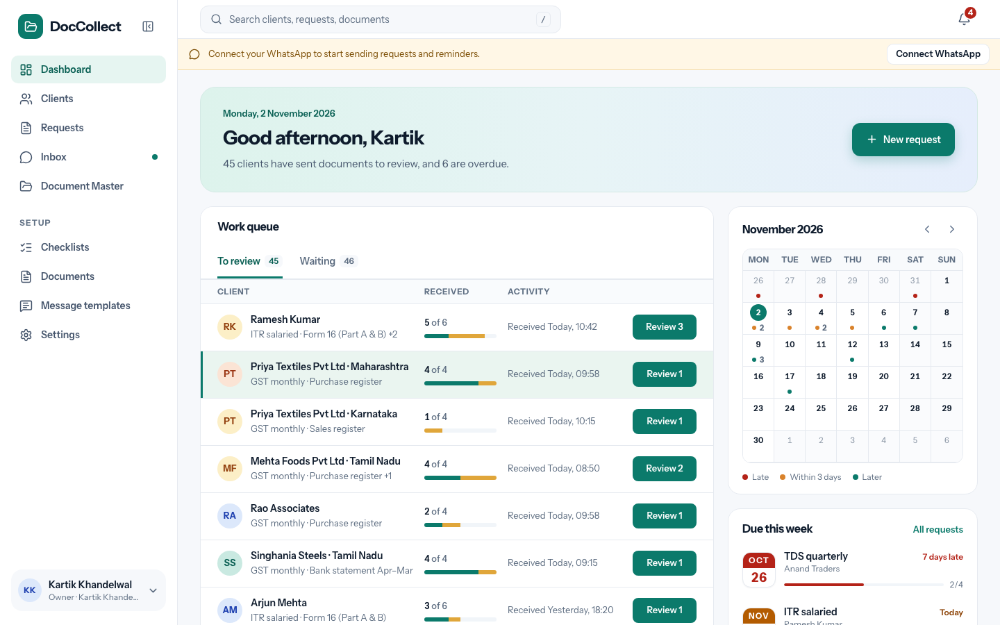

*Figure: The banner when WhatsApp is not connected.*

When WhatsApp is **not connected**, the banner says "Connect your WhatsApp to start sending requests and reminders." and the button says **Connect WhatsApp**.

- When the number is connected but WhatsApp has not approved the messages yet, it says "Your WhatsApp is connected. Waiting for WhatsApp to approve your messages, then you can send." and the button says **See status**.
- When WhatsApp has logged the number out, it says "Your WhatsApp got disconnected. Connect it again to send requests and reminders." and the button says **Connect again**.
- When the firm is ready, there is no banner.
- All three buttons open the WhatsApp tab in Settings.

## When a send is blocked

If the user tries to send while the firm is not ready, a dialog opens and nothing is created or sent. These actions open it: **Send** in a new request, **Remind** and **Send update** on a request and on the Dashboard, **Remind N clients**, and **Send a new link**.

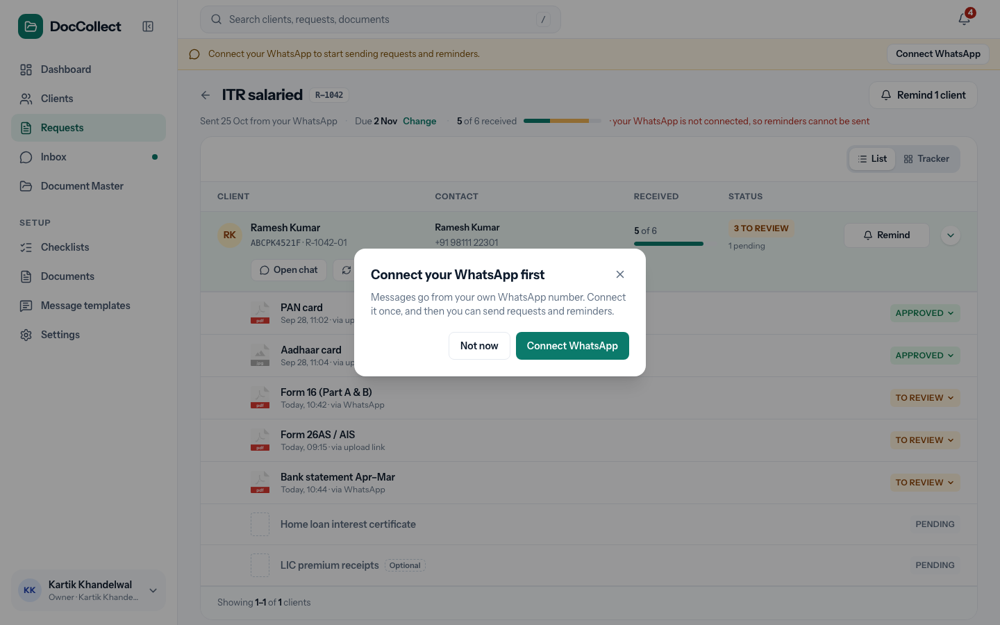

*Figure: The dialog when WhatsApp is not connected.*

The dialog has a title, a sentence or two, and two buttons. **Not now** closes it. The other button goes to Settings. The title and the button change with the situation.

| Situation | Title | Button |
|---|---|---|
| Not connected | Connect your WhatsApp first | **Connect WhatsApp** |
| Waiting for approval | Waiting for WhatsApp approval | **See status** |
| Disconnected | Your WhatsApp is disconnected | **Connect again** |
| One message not approved | This message is waiting for approval | **See status** |

## Connecting the number

In Settings, the **WhatsApp** tab shows the title **Your WhatsApp** and a line: "Your requests and reminders go to clients from your own WhatsApp number. Connect it once, and clients can reply in the chat." When no number is connected, one card, **Connect your own WhatsApp**, explains three steps: press the button, link your number on the page that opens (it takes about two minutes), and come back. Under the steps is the button **Connect your own WhatsApp**, with the line "Until you connect, you cannot send requests or reminders."

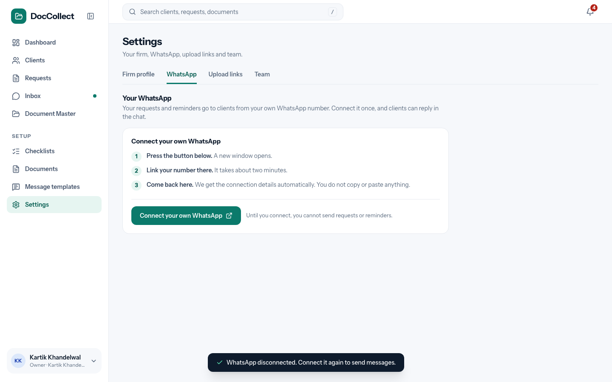

*Figure: The WhatsApp tab when no number is connected.*

The button opens Ramwin's page. The user completes the process there on their own, as Ramwin's integration flow decides. Once the number is connected, DocCollect receives the channel id and sends all the message templates to WhatsApp for approval by itself. The user returns to Settings.

## Connected, waiting for approval

After connecting, the card **Your connection** shows a green **Connected**, the WhatsApp number and the name clients see. Under them a box says **Message templates: waiting for approval**, with the line "You can send requests and reminders once WhatsApp approves your messages. This usually takes a short while." The button **Check status** refreshes it.

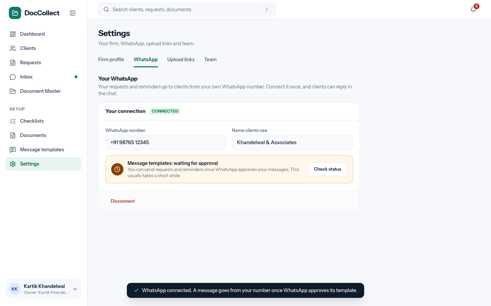

*Figure: Connected, with the messages waiting for approval.*

WhatsApp approves the messages a few at a time.

- While some are approved, the box says "Message templates: 6 of 7 approved" and "You can send now. A few messages are still waiting for approval." The firm sees only the count.
- The firm never sees which message is waiting, or why.
- When all are approved the box turns green and says "Message templates: all approved. You can send requests and reminders." The **Check status** button goes, and so does the banner.

## Disconnect, and a lost connection

**Disconnect** is at the bottom of the card. It asks "Disconnect your WhatsApp?" and explains that nothing can be sent until the user connects again, that reminders of requests already sent will wait, that clients who already have an upload link can still use it, and that the old chats stay in the Inbox. The buttons are **Cancel** and **Disconnect**.

If WhatsApp logs the number out or blocks it without the firm pressing Disconnect, the card shows a red **Disconnected**, and a red box says "WhatsApp logged this number out. Nothing can be sent until you connect it again. Your requests, chats and documents are safe." with the button **Connect again**. The banner shows on every page, and every send opens the dialog. **Connect again** goes through Ramwin's page again, and WhatsApp approves the messages again.

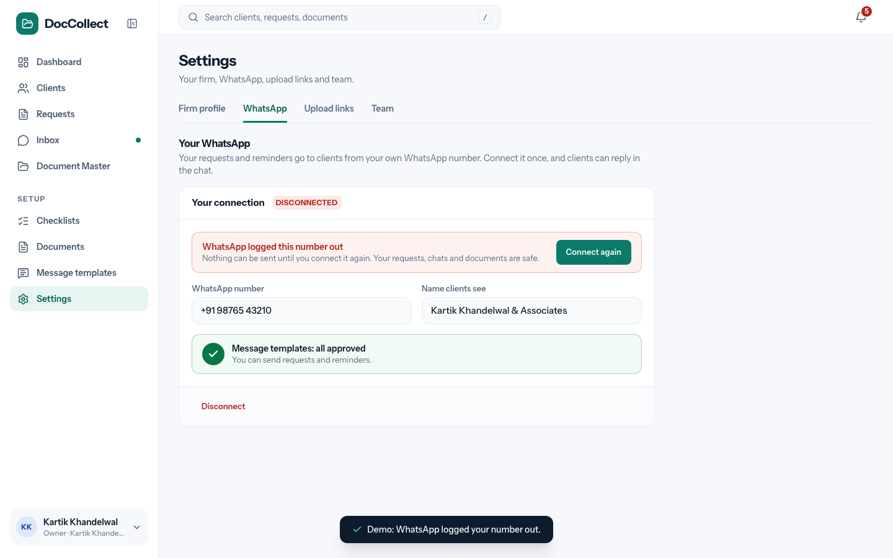

*Figure: The WhatsApp tab after WhatsApp logged the number out.*

## What other screens do

While the firm is not ready, the **Remind** buttons on the Dashboard and on a request open the dialog and send nothing.

- The last step of a new request shows "Not connected" in red, and **Send** opens the dialog without creating anything.
- In the Inbox, old chats can still be read, a yellow bar says "Your WhatsApp is not connected" with the button **Connect WhatsApp**, and the typing box is locked.
- The Message templates page shows every message as **Pending**.
- Sending a document back still works: the document is marked Rejected, the client is not messaged, and the screen says so.
# Dashboard

## Purpose

The Dashboard is the first screen after opening the product. It answers one question: **what needs me today?** It covers the whole firm.

The Dashboard decides nothing and changes nothing. It shows what is waiting, and sends the user to the screen where the work is done. Every row on it can be opened.

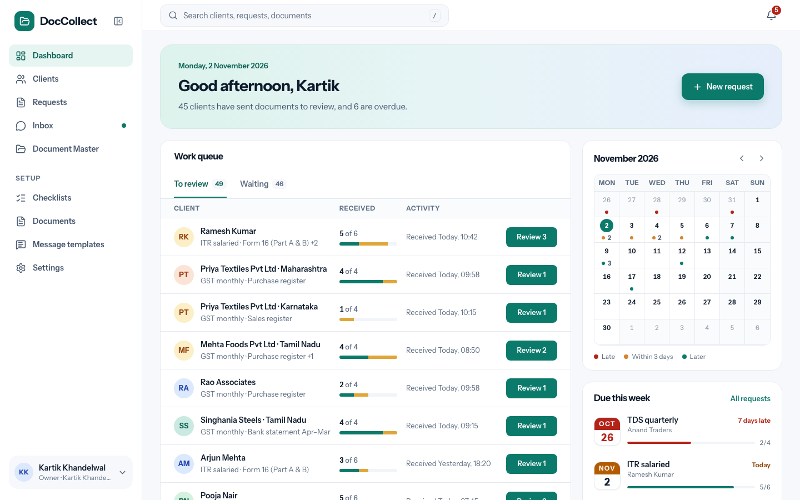

*Figure: The whole Dashboard.*

## Where it fits in the flow

The Dashboard is the roll-up of every request line (see How the Product Works). Each row is one client in one request. A client who has sent files appears under **To review**, and a client who still owes documents appears under **Waiting**. This is steps 6 and 7 of the journey: review and chase.

### What the Dashboard counts

Every figure and every row on the Dashboard follows the same rules.

| Rule | Detail |
|---|---|
| **Whole firm** | The Dashboard counts the whole firm. There is no "my clients" switch. |
| **One row is one client in one request** | A client with two requests, or with two GSTINs, has two rows. This keeps the unit of work small: the firm never faces hundreds of loose documents. |
| **Optional documents** | An optional document that the client has not sent never counts as missing, and never puts a client on the **Waiting** tab. |
| **Not applicable** | A document marked not applicable is left out of every count. |
| **Completed requests** | A completed request is not shown in the queue, the calendar or Due this week. |

## What the user sees

From top to bottom and left to right, the screen has these parts:

1. A greeting banner, with the date and the button **New request**.
2. The **Work queue**, with two tabs, **To review** and **Waiting**.
3. A **calendar** of the month.
4. **Due this week**, under the calendar.

## The greeting banner

| Element | What it shows |
|---|---|
| **Date** | Today, for example "Monday, 2 November 2026". |
| **Title** | "Good morning, <first name>" before 12:00, "Good afternoon" from 12:00 to 17:00, "Good evening" after. The name is the first name of the firm's owner. |
| **One line under the title** | If the firm has no request at all: "Nothing here yet. Send your first request and this page will show what needs you." If nothing needs the firm: "Nothing needs you right now." Otherwise it says how many clients have sent documents to review and how many requests are overdue. |
| **Button New request** | On the right of the banner. Opens a new request. |

The number of clients in the line counts clients with files to review. It does not count files from unknown numbers, so it can be smaller than the number on the **To review** tab.

## The Work queue

The Work queue has the title **Work queue**, two tabs with their counts, and the column heads **Client**, **Received** and **Activity**. **To review** is open when the page loads.

- Only the first nine rows of a tab are shown.
- A link under the list says **View all N clients** when there are more than nine, and **Open Requests** when there are not.

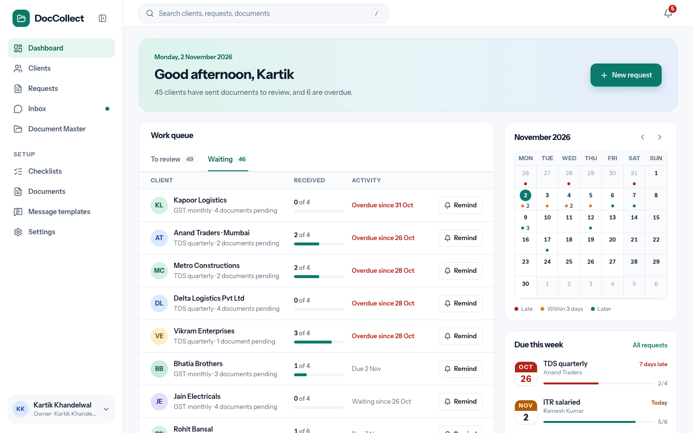

*Figure: The Waiting tab.*

Every row has the same parts.

| Part | What it shows |
|---|---|
| **Avatar and name** | The client's name. For a client with several GSTINs or TANs the place follows, for example "Priya Textiles Pvt Ltd · Karnataka". |
| **Line under the name** | The request and the files. On **To review**: "GST monthly · Purchase register +1", which is the first file and how many more. On **Waiting**: "TDS quarterly · 2 documents pending". |
| **Received** | "5 of 6", which is files received out of files asked, and a small bar. Green is approved, amber is still to review, grey is received but not yet decided, and red is overdue. |
| **Activity** | On **To review**, for example "Received Today, 10:42", the time the first waiting file came. On **Waiting**, for example "Overdue since 31 Oct" in red and bold, "Waiting since 26 Oct" when nothing has come, or "Due 7 Nov". The dates and times here are only examples. |
| **Button** | **Review N** or **Remind**, as below. |

### The three kinds of row

| Row | Tab | What it is | Button and what it does |
|---|---|---|---|
| **Files to review** | To review | A client in a request who has at least one file waiting for the firm's decision. | **Review N**, where N is the files to review for that client in that request. Opens that client inside the request page. |
| **Unassigned** | To review | A grey chat icon, the line "<n> files from <number>", the text "We could not tell which client sent these", and the tag **Unassigned**. | **Review**. Opens the Inbox on that chat. |
| **Waiting for documents** | Waiting | A client who still owes documents and has nothing waiting for review. Late ones come first. | **Remind**. Sends a reminder on WhatsApp. |

A client with files to review is on **To review** only. The client is not on **Waiting**, even if more documents are still missing.

- When the firm has decided on all the waiting files, the client moves to **Waiting** if documents are still missing.
- Rows for unknown numbers come after all the client rows, so when there are more than nine client rows, they are not among the nine shown.

> **NOTE** The Dashboard shows the first nine rows on purpose. The full list, with search and paging, is on the Requests screen.

### What Remind does

**Remind** sends the right message for that client (see Requests, "Reminding clients") and the screen says "Reminder sent to <name> on WhatsApp". If the firm cannot send, the dialog from Connect Your WhatsApp opens. If the client's number is not on WhatsApp, the screen says "Could not send to <name>: Not on WhatsApp", and the reminder is not counted.

## The calendar

The calendar shows the month and year, for example "November 2026", with arrows to go to the next and the previous month. Weeks start on Monday.

- Today is a green circle, and days of the neighbouring months are grey.
- A day on which a request has its last date shows a dot, with a small number when two or more requests are due that day.
- A key under the calendar explains the dot colours: red means late, orange means within three days, and green means later.
- A click on a day opens the request due on that day.

## Due this week

This card lists the next last dates of open requests, with the request, the client and a line such as "7 days late" or "Today". A link, **All requests**, opens the Requests screen. A click on an item opens that request.

## What each click does

This table lists every control on the screen, where it is, and what happens when the user clicks it.

| Where | Click | What happens |
|---|---|---|
| Greeting banner | **New request** | Opens New Request, step 1. |
| Work queue, tabs | **To review** | Shows the clients who have files waiting. |
|  | **Waiting** | Shows the clients who still owe documents. |
| A To review row | **Review N** | Opens the request page with that client's row opened. |
| An Unassigned row | **Review** | Opens the Inbox on that chat. |
| A Waiting row | **Remind** | Sends the reminder and says "Reminder sent to <name> on WhatsApp". If sending is not possible, a dialog opens. |
| Under the list | **View all N clients** or **Open Requests** | Opens the Requests list. |
| Calendar | The arrows | Show the next or the previous month. |
|  | A day with a dot | Opens the request that is due that day. |
| Due this week | An item | Opens that request. |
|  | **All requests** | Opens the Requests list. |

# Clients

## Purpose

The Clients section has two screens: the **Clients list**, which is the whole client book, searchable and filterable, and the **client page**, which shows everything about one client in one place: who the client is, who handles each registration, every registration, the open requests, the documents, and the chat.

## Where it fits in the flow

The list is the result of the sync from KDK, and the client page shows the data that came in. A request is made against the registrations of a client (see New Request). The contact of each registration decides who receives the WhatsApp message.

## One client, many registrations

A client is one PAN. Under it sit its **Income tax registration**, which is the PAN itself, any number of **GSTINs**, normally one for each state, and any number of **TANs**. One business with three GSTINs and a TAN is one client, shown once, with everything under it.

The **contact** is kept for each registration, not for the whole client. A branch is often handled by a different person, so the messages for that registration go to its own contact.

- One contact can look after several registrations, and even several clients.
- When that happens the product says so, and that person has one chat in the Inbox.
- Every request still gets its own message and its own link.

> **NOTE** All clients, registrations and contacts come from KDK. Adding a client by hand is not part of this version.

## The Clients list

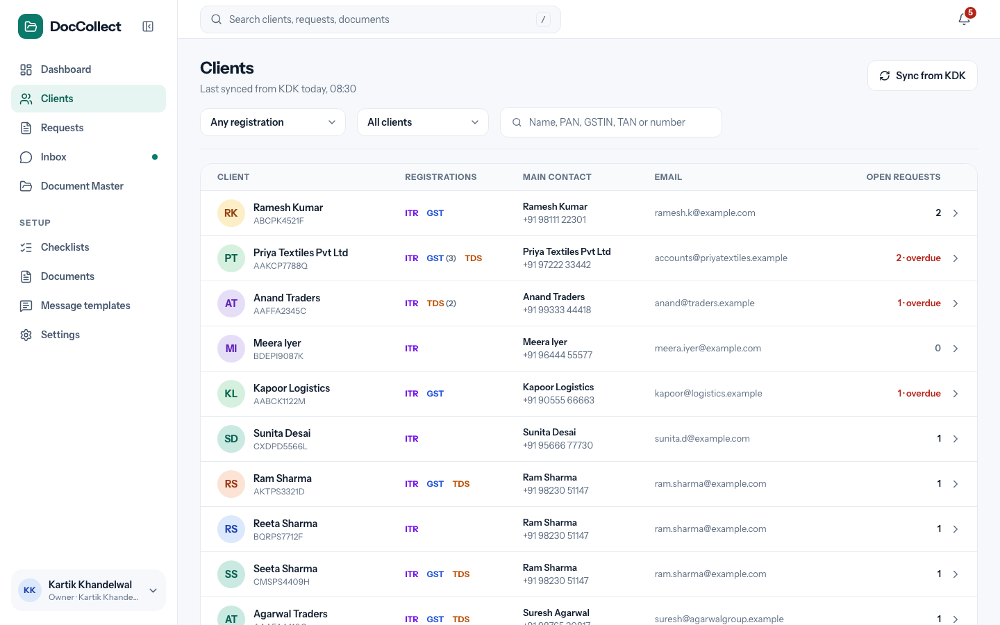

*Figure: The Clients list.*

### What the user sees

From top to bottom: the page header with the sync button, a row of filters, the client table with one row for each PAN, and the page bar.

### The page header

The header has the title **Clients** and the line, for example, "Last synced from KDK today, 08:30". The button **Sync from KDK** brings in new and changed clients now. In the prototype it only says "Sync needs the KDK connection. In this demo the clients are sample data."

### The filters

Both filters and the search box work together.

| Filter | Options | What it does |
|---|---|---|
| **Registration** | **Any registration** (the default) | Every client. |
| | **Has GST** | Clients with at least one GSTIN. |
| | **Has TDS** | Clients with at least one TAN. |
| | **Has GST and TDS** | Clients with both. |
| | **Multiple GSTINs or TANs** | Clients with more than one GSTIN or TAN. |
| | **Income tax only** | Clients with no GSTIN and no TAN, only the PAN. |
| **Requests** | **All clients** (the default) | Every client. |
| | **With open requests** | Clients with at least one open request. |
| | **Overdue** | Clients with at least one overdue request. |
| | **Nothing open** | Clients with no open request. |
| **Search box** | Any text | The client's name, PAN, GSTIN, TAN or mobile number. |

If nothing matches, the screen says "No client found. Nothing matches what you typed or the filters you chose." If there are no clients at all, it says "No clients yet. Your clients come from KDK: one record for each PAN, with their GSTINs and TANs. Sync to bring them in, then send a request." with the button **Sync from KDK**.

### The client table

There is one row for each client. A click anywhere on the row opens the client page.

| Column | What it shows |
|---|---|
| **Client** | The initials, the name in bold and the PAN under it. |
| **Registrations** | Chips for what the client has: **ITR**, **GST** and **TDS**. A number appears on a chip when the client has several, for example GST (3). |
| **Main contact** | The name and mobile number of the main contact. |
| **Email** | The main contact's email. |
| **Open requests** | The number of open requests. "2 · overdue" in red when some are late. A small arrow shows that the row opens. |

The list is paged, with the page bar under it.

## The client page

### How it is reached

The page opens from a row in the Clients list, from the name of a client in a request, from **Open** on a client's folder, and from a registration in a link.

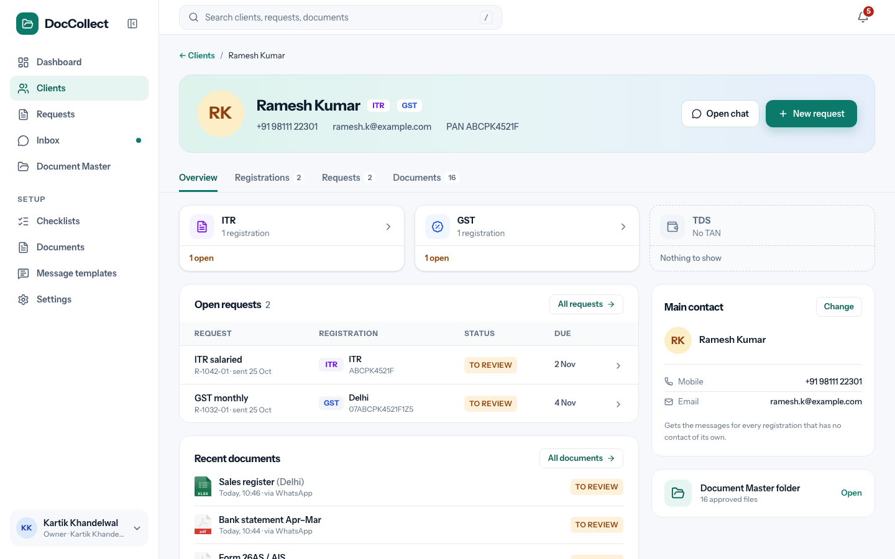

*Figure: The client page, Overview tab.*

### The header

| Element | What it shows |
|---|---|
| **Back link** | "← Clients" and the client's name. |
| **Name, chips and details** | The initials, the name, chips (ITR, GST, TDS), mobile, email and PAN. |
| **Button Open chat** | Opens this client's chat in the Inbox. If the client has no chat yet, the Inbox says so. |
| **Button New request** | Opens a new request with this client already ticked. |
| **Tabs** | **Overview**, **Registrations** (with a count), **Requests** (with a count), **Documents** (with a count). |

### Overview

| Part | What it shows | What a click does |
|---|---|---|
| **Cards ITR, GST, TDS** | For each kind, how many registrations and how many open requests. A kind the client does not have says "Nothing to show". | The whole card opens the Registrations tab. |
| **Open requests** | The request, its number, the registration, the status and the due date. | A row opens the request. **All requests →** opens the Requests tab. |
| **Main contact** | Name, mobile and email, with the note "Gets the messages for every registration that has no contact of its own." | **Change** (see Changing a contact). |
| **Recent documents** | The latest files, with the status and where they came from. | **All documents →** opens the Documents tab. |
| **Folder in Document Master** | "16 approved files". | **Open** goes to the client's folder. |

### Registrations

The client is drawn as a tree, read from left to right: the client, then **ITR**, **GST** and **TDS**, then each registration with its place, its number, its contact and "1 open" when a request is open. A registration whose contact is the client's own main contact says "Main contact". A kind the client does not have is a dashed card, for example "TDS · No TAN".

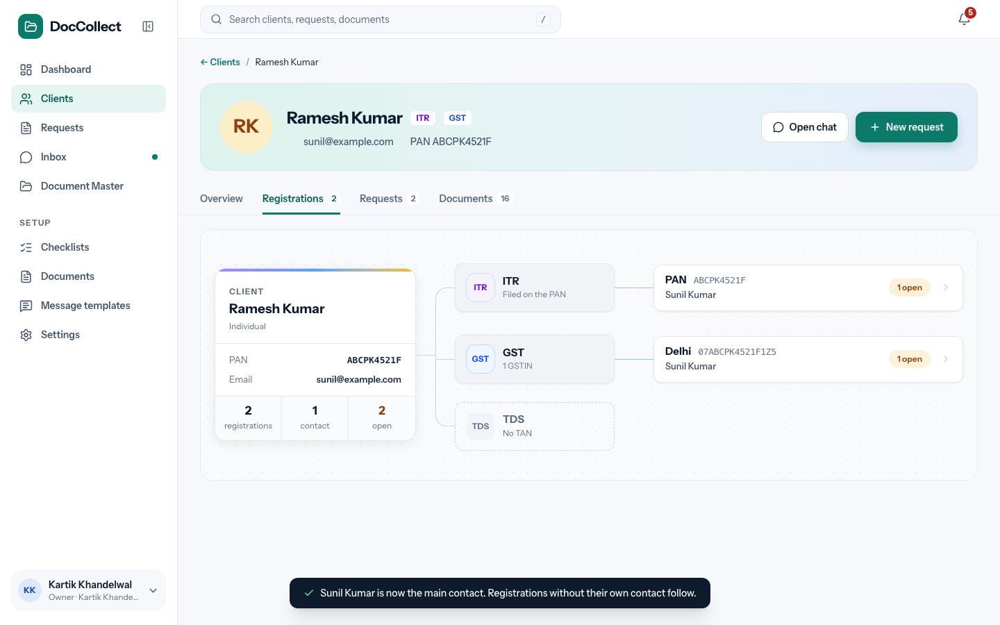

*Figure: The Registrations tab.*

### Requests

The tab has buttons **All**, **Income tax**, **GST** and **TDS**, each with a count, a **Registration** dropdown, a status dropdown (open, overdue, completed) and a search box, "Search request or number".

- A line says "Showing X of Y requests", with **Clear filters**.
- The table shows one row for each request and registration: the request, the registration, the documents done, the status and the due date.
- A click on a row opens the request.
- The table is paged.

### Documents

The tab shows the client's folders from Document Master. A click on a folder opens it there.

## One registration

A click on a registration opens a panel on the right.

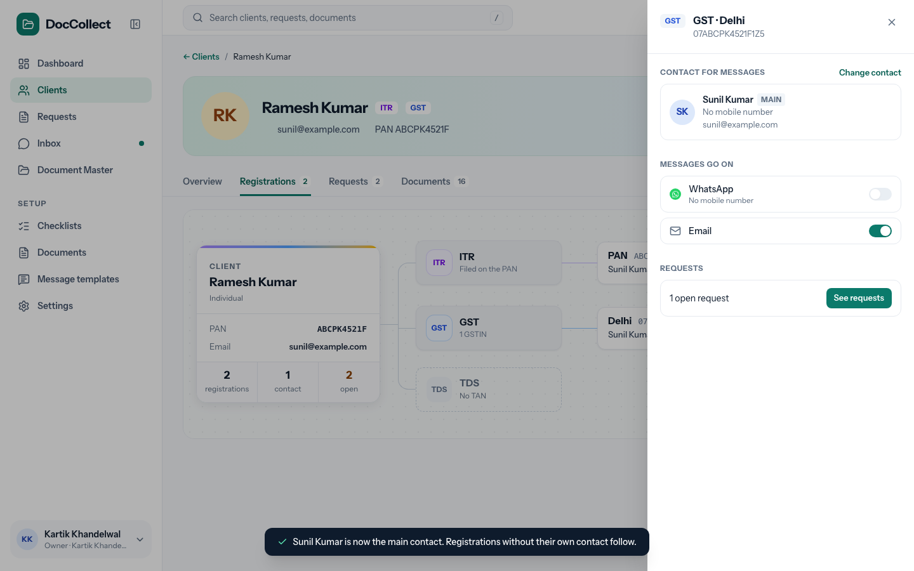

*Figure: The registration panel.*

| Element | What it shows or does |
|---|---|
| **Heading** | The registration, for example **Delhi · 07ABCPK4521F1Z5**, and its kind. |
| **Contact** | The contact's name, mobile and email, and the button **Change contact**. |
| **Switch WhatsApp** | On: this registration gets WhatsApp messages. Off: it gets none. A request still creates its line, but sends it no WhatsApp message, and the Request sent screen says so. |
| **Switch Email** | Only a switch for now. No email is sent. |
| **See requests** | Opens the Requests tab filtered to this registration. |

A contact with no mobile number cannot have WhatsApp turned on. The switch is off, and under its name it says "No mobile number". A contact with no email cannot have Email turned on, and it says "No email".

## Changing a contact

**Change** on the main contact, or **Change contact** in the panel, opens a window that lists all the contacts of the client and which registrations each looks after. The user can pick one, choose **Add a new contact**, or choose **Edit** on a contact. Editing changes the contact for every registration that uses it, and the window says so.

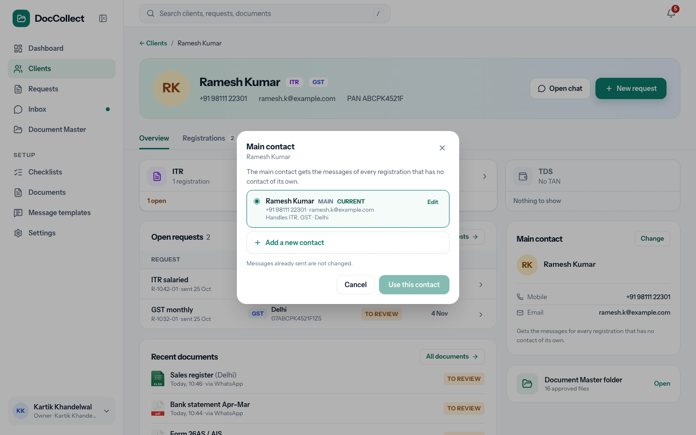

*Figure: Changing a contact.*

The form has three fields, and the button **Save** stays disabled while there is a problem.

| Field | Rule | Message |
|---|---|---|
| **Name** | Needed. | "Name is required." |
| **Mobile number (10 digits)** | Ten digits. A +91 in front is accepted and removed. | "Mobile number must be 10 digits." |
| **Email** | Must look like an email address. | "Email does not look right." |
| Both mobile and email empty | At least one is needed. | "Add a mobile number or an email." |

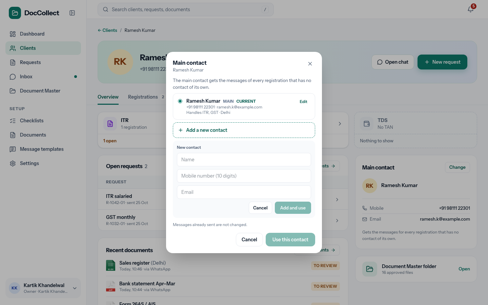

*Figure: Adding a contact.*

## Special cases

| Case | What the user sees |
|---|---|
| A client with many GSTINs | One client with one card for each GSTIN. Each has its own contact, requests, message and link. |
| One person looks after several clients | The client page says so. That person has one chat, but every request has its own message and link, and the greeting uses the client's own name. |
| A message fails because the number is not on WhatsApp | The number shows a red **Not on WhatsApp**, on the request and here. The firm can change the contact. |

## What each click does

This table lists every control on the screen, where it is, and what happens when the user clicks it.

| Where | Click | What happens |
|---|---|---|
| Clients list | **Sync from KDK** | Brings in new and changed clients now. |
|  | A filter box | Opens its choices under the box. Choosing one narrows the list at once. |
|  | The search box | Narrows the list as the user types. |
|  | A row | Opens the client page. |
|  | Page numbers and rows per page | Show that page. |
| Client page header | **← Clients** | Goes back to the list. |
|  | **Open chat** | Opens this client's chat in the Inbox. |
|  | **New request** | Opens New Request with this client ticked. |
|  | A tab | Shows **Overview**, **Registrations**, **Requests** or **Documents**. |
| Overview | A card **ITR**, **GST** or **TDS** | Opens the Registrations tab. |
|  | A request row | Opens the request. **All requests →** opens the Requests tab. |
|  | **Change** | Opens the window to change the main contact. |
|  | **All documents →** | Opens the Documents tab. |
|  | **Open** on the folder card | Opens the client's folder in Document Master. |
| Registrations | A registration card | Opens the registration panel. |
| Registration panel | **Change contact** | Opens the contact window. |
|  | The switches **WhatsApp** and **Email** | Turn on or off at once. |
|  | **See requests** | Opens the Requests tab for this registration. |
|  | × | Closes the panel. |
| Contact window | A contact | Selects it. |
|  | **Edit** or **Add a new contact** | Opens the form. |
|  | **Save** | Saves and closes the window. |
|  | **Cancel** | Closes the window with nothing changed. |

# New Request

## Purpose

A request asks one or more registrations for the documents of one checklist, with one last date. The user makes it in three steps: **What you need**, **Who to ask** and **Review and send**. When the user presses **Send**, one WhatsApp message goes to each client, with that client's own link.

## Where it fits in the flow

This is step 4 of the journey: ask. It is the only place where a request is made.

### Where the user starts

| From | What is already filled in |
|---|---|
| **Dashboard** or **Requests**, button **New request** | Nothing. Step 1 is empty. |
| **A client page**, button **New request** | That client is already ticked in step 2. |
| **The Inbox**, button **New request** in the panel of a chat that has no open request | That client is already ticked in step 2. |
| **The Tracker**, button **Ask for missing documents** | The ticked clients are chosen, and each client is asked only for what that client is missing. |

## What the user sees

At the top is a back arrow, "Back to requests", and a step bar: **1 What you need**, **2 Who to ask**, **3 Review and send**. A finished step shows a tick. At the bottom, **Cancel** (step 1) or **← Back** (steps 2 and 3) is on the left, and the main button is on the right. **Cancel** leaves the request without saving anything.

| Step | Title | The line under the title | Main button |
|---|---|---|---|
| 1 | What do you need? | Pick a checklist, then change its documents if you need to. | **Continue to who →** |
| 2 | Who should get it? | Only GST registrations are listed. (Or Income tax, or TDS.) | **Continue to review →** |
| 3 | Check and send | This is what your clients will receive. | **Send N messages** |

## Step 1: What you need

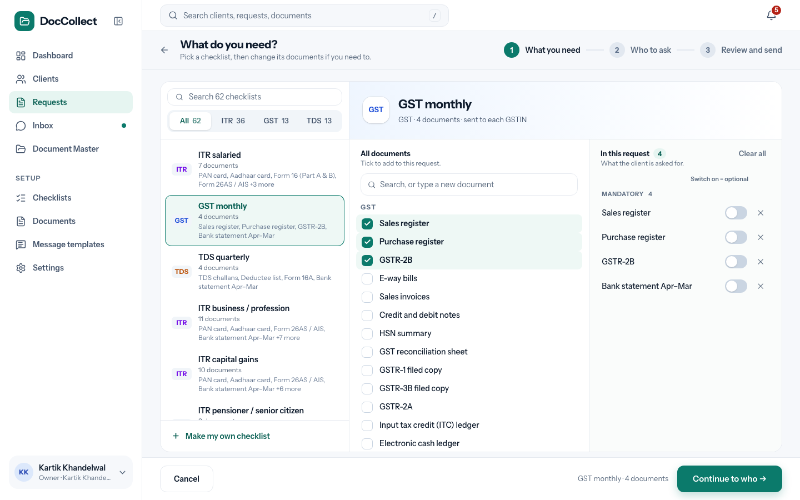

*Figure: Step 1, What you need.*

The screen has three parts.

### The checklists (left)

| Element | What it shows or does |
|---|---|
| **Search box and tabs** | Tabs **All**, **ITR**, **GST** and **TDS**, each with a count. |
| **The list** | Each checklist with its kind and a line of its documents. A click picks it. |
| **Make my own checklist** | At the bottom. Starts an empty checklist (see below). |

The checklist the user picks decides the kind of request, and so which registrations step 2 offers. If the user changed the documents and then picks another checklist, a window asks "Change the checklist?" and says "You changed the documents of this checklist. If you switch to “<name>”, those changes are lost." The buttons are **Keep my changes** and **Switch**. If no checklist matches the search, the list says "No checklist matches."

### All documents (middle)

The line says "Tick to add to this request." There is a search box, "Search, or type a new document", and the documents grouped by category, each with a tick box. A tick adds the document to the request as mandatory. If nothing matches, the list says "No document matches." and the typed name can be added as a new document, which also goes into the firm's Documents list.

### In this request (right)

The line says "What the client is asked for." The chosen documents are in two groups, **Mandatory** and **Optional** ("Client can skip these. Nobody is reminded.").

- Every document has a switch, and the line above says "Switch on = optional".
- The switch makes the document optional for this request only.
- **Clear all** empties the list, and × removes one document.
- An empty list says "Nothing here yet. Tick documents on the left."

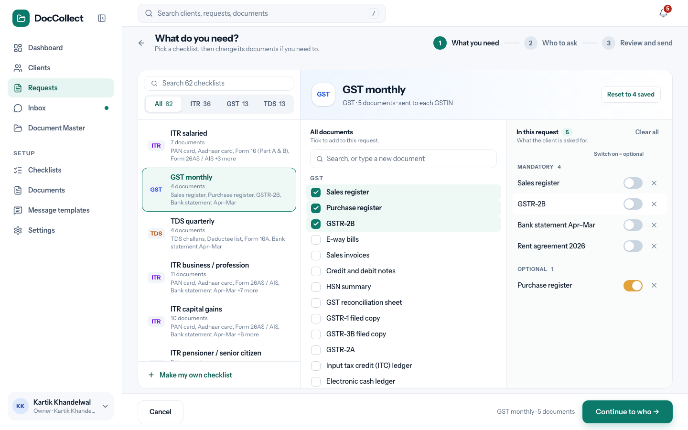

*Figure: A document switched to Optional.*

### Rules for step 1

| Rule | Detail |
|---|---|
| **At least one mandatory document** | **Continue to who →** is disabled until the request has one. If every document is optional, a message says "Keep at least one document mandatory, or the request has nothing to wait for." |
| **Optional is for this request only** | The document stays mandatory in the Documents list. After the request is sent, the choice is fixed. |
| **Make my own checklist** | The top of the screen becomes one row: the kind (**Income tax**, **GST** or **TDS**), a **Name** box ("Name your checklist"), and a tick **Keep for next time**, on at first. When it is on, the list is saved as a new checklist when the request is sent. |
| **A new document typed here** | It is added to the firm's Documents list for next time. |

## Step 2: Who to ask

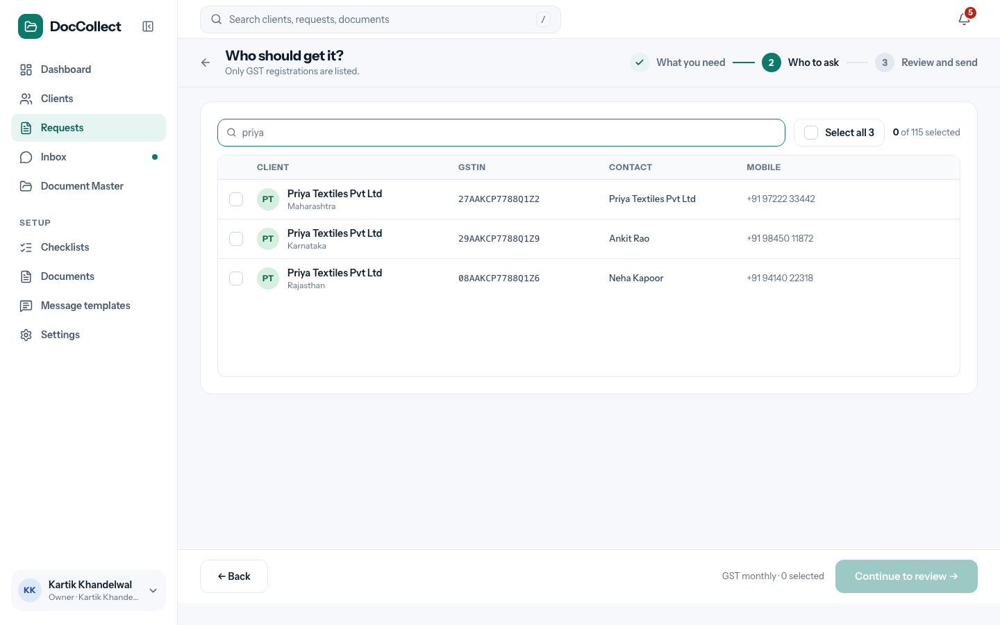

*Figure: Step 2, Who to ask.*

The screen has a search box, "Search name, number or PAN", a tick **Select all** with the count, and a line such as "0 of 115 selected". The table shows a tick box, the **Client** with its place, the number (**GSTIN**, **TAN** or **PAN**, as the kind needs), the **Contact** and the **Mobile**.

| Rule | Detail |
|---|---|
| **Only registrations of the chosen kind** | A GST checklist lists GSTINs, a TDS checklist lists TANs, an Income tax checklist lists PANs. |
| **Once for each registration** | A client with several GSTINs or TANs appears once for each, because each gets its own message and link. |
| **WhatsApp switched off** | The registration can be ticked, but gets no WhatsApp message. The Request sent screen says so. |
| **Select all** | Ticks every registration shown. With a search typed, it ticks only the matches. |
| **Continue to review →** | Enabled when at least one registration is ticked. |

## Step 3: Review and send

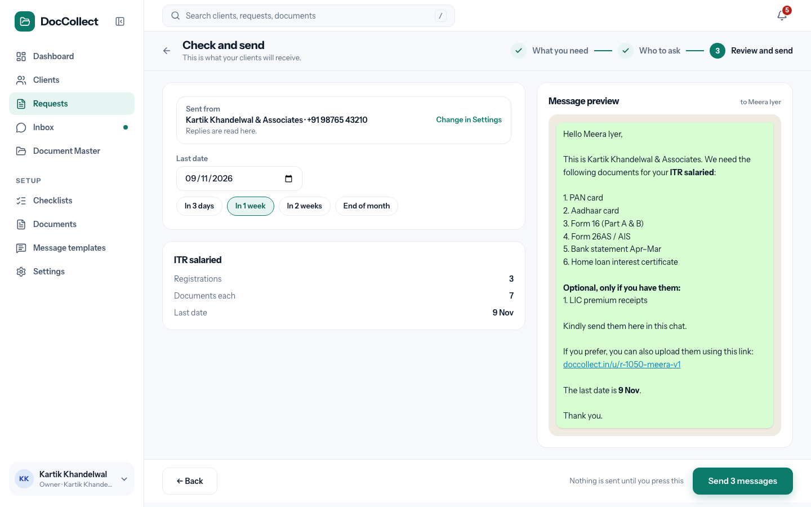

*Figure: Step 3, Review and send.*

| Element | What it shows |
|---|---|
| **Sent from** | The firm's WhatsApp name and number, the line "Replies are read here.", and the link **Change in Settings**. |
| **Last date** | A date box, already filled with a suggested date, and four buttons: **In 3 days**, **In 1 week**, **In 2 weeks**, **End of month**. |
| **Summary** | The checklist, the number of registrations, the documents for each, and the last date. |
| **Message preview** | The exact message the first client will get: the mandatory documents first, then "Optional, only if you have them:" and the optional ones, and the client's link. Other clients get their own name, documents and link. |
| **Send button** | **Send N messages**, where N is how many clients get a WhatsApp message. Under it: "Nothing is sent until you press this." It is disabled when the last date is empty. |

### When the firm is not ready to send

The **Sent from** box says "Not connected" in red, with "Connect your WhatsApp to send this request." It says "Your WhatsApp got disconnected. Connect it again to send this request." when WhatsApp logged the number out, and "Waiting for WhatsApp to approve your messages. You can send once they are approved." when the messages are not approved yet. Pressing **Send** opens the dialog from Connect Your WhatsApp. **Nothing is created.**

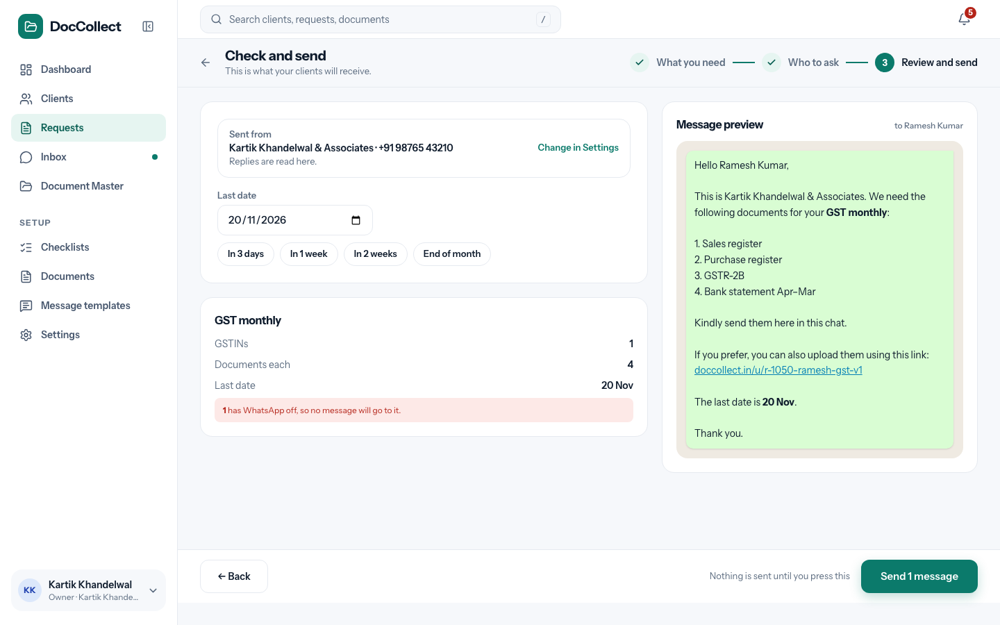

*Figure: Step 3 when WhatsApp is not connected.*

## Request sent

On **Send**, the request is made with the next number, for example **R-1050**. Each client gets a line number (R-1050-01 and so on), one message goes to each client, and the message also appears in the client's chat in the Inbox.

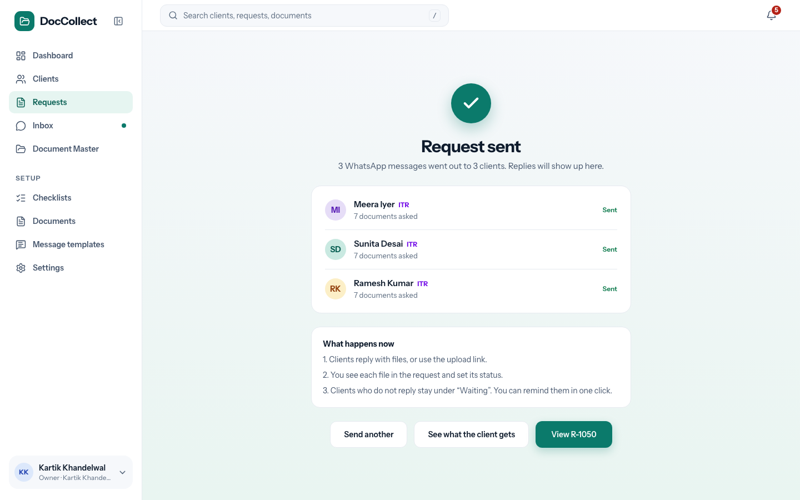

*Figure: The Request sent screen.*

| Element | What it shows or does |
|---|---|
| **Green tick and Request sent** | Confirms it. |
| **One line** | "1 WhatsApp message went out to 1 client. Replies will show up here." |
| **Client list** | Each client with **Sent** and how many documents were asked. |
| **What happens now** | Clients reply with files or use the upload link. You see each file in the request and set its status. Clients who do not reply stay under "Waiting", and you can remind them in one click. |
| **Send another** | Starts a new request. |
| **See what the client gets** | Opens the client's upload page. |
| **View R-1050** | Opens the request. |

| Case | What the user sees |
|---|---|
| A client's number is not on WhatsApp | A red note: "Could not send to <names>: Not on WhatsApp. Check the number on the client page, or share the upload link in another way." That client does not show **Sent**. |
| A client's WhatsApp switch is off | That client gets no message, and the note says so. |
| A client has nothing to be asked | That client gets no message. |

# Requests

## Purpose

The Requests section has two screens: the **Requests list**, which shows every request the firm has sent and where it stands, and the **request page**, where the firm follows up one request: it reminds clients, reviews files, approves them or sends them back, and sends new links.

## Where it fits in the flow

This is steps 6 and 7 of the journey: review and chase. Every file the client sends ends up here as **To review**, and every decision the firm makes, approve or send back, is made here or in the Inbox.

## The Requests list

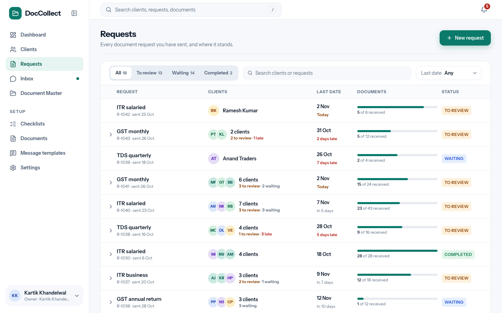

*Figure: The Requests list.*

### What the user sees

From top to bottom: the header with the button **New request**, the tabs, the filters and search box, and the table.

### Filters and search

| Control | Options | What it shows |
|---|---|---|
| **Tabs** | **All**, **To review**, **Waiting**, **Completed**, each with a count | Only the requests in that state. |
| **Last date** | **Any** (the default) | Every request. |
| | **Late** | Requests whose last date has passed. |
| | **In 7 days** | Requests that are not finished and are due within the next 7 days. |
| | **Later** | Requests that are not finished and are due after more than 7 days. |
| **Search box**, "Search clients or requests" | Any text | The request name, the request number (R-1042), a client's name, PAN, GSTIN, TAN or mobile number, and a client's line number (R-1042-01). |

The tab, the date filter and the search work together. If nothing matches, the list says that no request matches what the user chose. If the firm has not sent a request, the list says so, with a button **New request**.

### The table

| Column | What it shows |
|---|---|
| **Request** | The name, the number and, for example, "sent 25 Oct". |
| **Clients** | Avatars, or the client's name when there is one client. A line such as "2 to review · 1 late". |
| **Last date** | The date, and "2 days late", "Today" or "In 5 days". |
| **Documents** | A bar, and "5 of 6 received". |
| **Status** | **To review**, **Waiting** or **Completed**. |

| Status | Meaning |
|---|---|
| **To review** | At least one file waits for the firm. |
| **Waiting** | Nothing waits for review, but clients still owe documents. |
| **Completed** | Every mandatory document of every client is approved. Optional documents never hold a request back. |

A click on a row opens the request page. The arrow at the left of a row, shown when the request has more than one client, opens a short list of its first five clients with their status.

- The table is paged.
- A request that does not exist, or a wrong link, shows "Request not found. This request may have been removed, or the link is not right."

## The request page

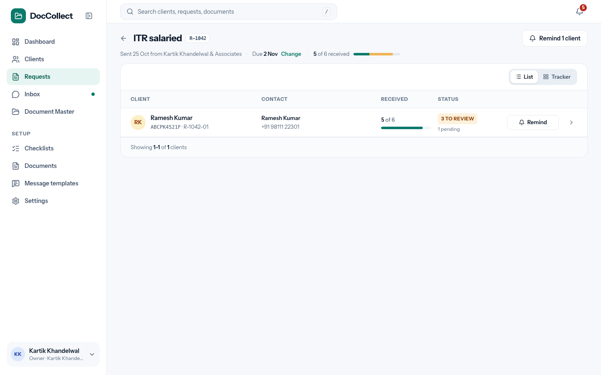

*Figure: The request page.*

### The header

| Element | What it shows or does |
|---|---|
| **Back arrow** | "Back to requests". |
| **Title** | The request name and number, for example **ITR salaried** and **R-1042**. |
| **Line under the title** | For example "Sent 25 Oct from <firm name>". |
| **Due <date>** and **Change** | The last date, for example "Due 2 Nov". **Change** opens the last date window. When the link has expired the line says "The upload link has expired". |
| **Progress** | "5 of 6 received" and a bar: approved, to review and still missing. |
| **Button Remind N clients** | N is how many clients would get a message. It says **Send update to N clients** when every client's required documents have all arrived. |
| **Switch List / Tracker** | Changes how the clients are shown. |

### Filters, search and sorting

The page has tabs **All**, **To review**, **Waiting** and **Complete**, each with a count, and a search box that finds a client in this request by name, number, PAN, GSTIN, mobile number or document.

- If nothing matches, the page says "No clients match." The rows come in this order by default: clients with files to review, then clients who are waiting, then the complete ones.
- A click on a column heading sorts again.
- **Client** sorts by name, **Received** sorts by how much has come, with the least first, and **Status** sorts with the files to review first.
- A second click reverses the order.

### One row for each client

| Part | What it shows |
|---|---|
| **Client** | The avatar, the name (a click opens the client page), the PAN, GSTIN or TAN, and the client's line number (R-1042-01). When a request mixes kinds, the kind is shown. For a client with several GSTINs the place is shown. |
| **Contact** | The contact's name and mobile for this registration. A red **Not on WhatsApp** follows the number after a failed send. |
| **Received** | "5 of 6". |
| **Status chip** | **To review** (with how many), **Waiting**, **Overdue** or **Complete**. |
| **Button** | **Remind** while documents are missing. **Send update** when every required document has arrived, whether it is waiting for review or approved. |
| **Arrow** | Opens the client's documents. |

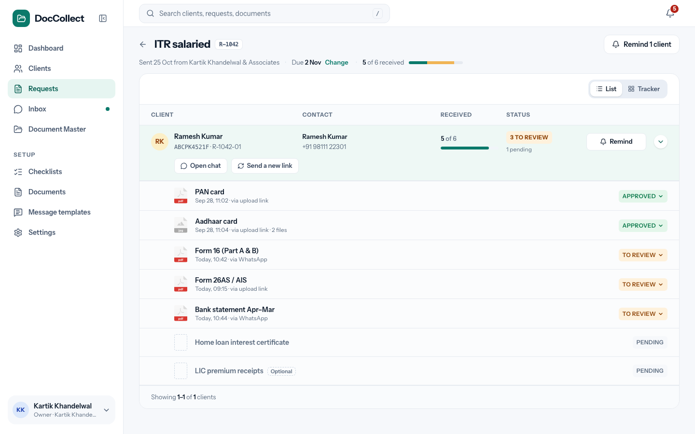

*Figure: A client's row, opened.*

An opened row has two buttons, **Open chat** and **Send a new link**, and one line for each document.

| Part of a document line | What it shows |
|---|---|
| **Icon** | The file type, or an empty box when nothing was sent. |
| **Name** | The document name, with a dashed **Optional** tag when it is optional. |
| **Line under the name** | When it came and how, for example "Today, 10:42 · via WhatsApp", "Sep 28, 11:02 · via upload link", "2 files". A document the client said they do not have shows "Client says this does not apply to them". |
| **Status button** | **Pending**, **To review**, **Approved**, **Rejected** or not applicable. A click opens the status menu. |

## Approving a document

The status button opens a small menu with **To review**, **Approved** and **Rejected**. The menu opens upward when there is no room below it. **To review** sets the status back at once and sends nothing. **Approved** opens the window below.

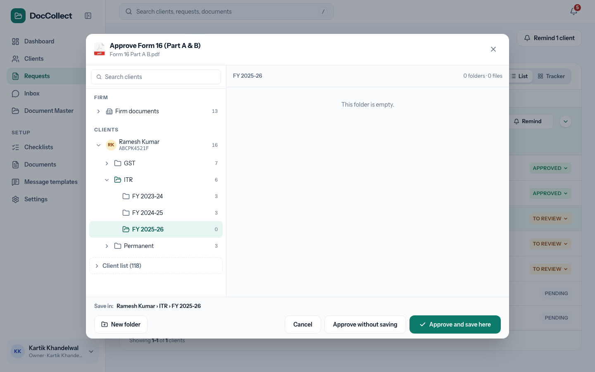

*Figure: Choosing where to keep the file.*

The window "Approve <document>" asks where to keep the file. On the left is a search box ("Search clients"), **FIRM** and **CLIENTS**, as a folder tree.

- On the right is the open folder with its files, or "This folder is empty." At the bottom a line says, for example, "Save in: <client name> › ITR › FY 2025-26".
- The folder we suggest is already open: the client, the registration, the year, or where the firm saved this kind of document before.
- For a document set as "Send only one time" the suggested folder is the client's **Permanent** folder.

| Button | What happens |
|---|---|
| **Approve and save here** | The status becomes **Approved** and the file is saved in the folder shown. |
| **Approve without saving** | The status becomes **Approved**. The file waits at the top of Document Master as "Not in a folder yet", to be saved later. |
| **New folder** | Asks for a name and makes a folder inside the open folder. |
| **Cancel**, or the close icon | Closes. The document is not approved. |

Nothing is filed without this answer. For a document with several files, all the files go to the folder together. Approving a document sends no message to the client, with one exception: when the document is the **last required** one of that client, so that all the client's required documents are now approved, the message **All documents approved** goes to the client by itself, straight after the approval. The same happens when the user approves from the Inbox.

When the message would not go, because WhatsApp is not connected or the message is not approved yet, the approval window says so beforehand in a note: "The client will not get the message 'All documents approved' because WhatsApp is not connected." or "…because this message is not approved by WhatsApp yet." The approval still goes through.

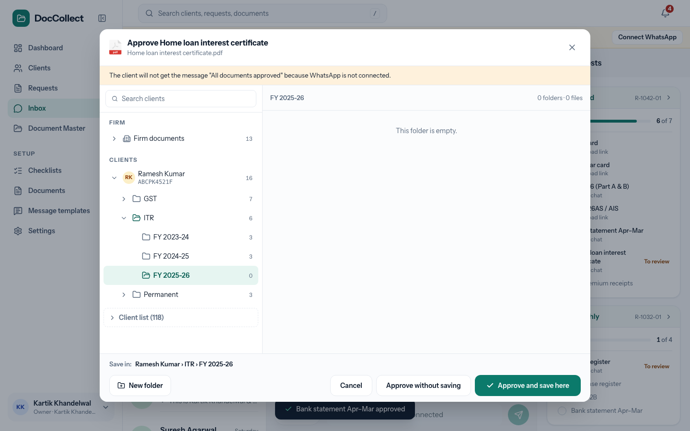

*Figure: The note in the Approve window, when WhatsApp is not connected.*

## Sending a document back

**Rejected** in the status menu, or **Send back** in the preview, opens the window "Reject “<document>”?". It says "Tell the client what is wrong. They get this on WhatsApp with the client's upload link."

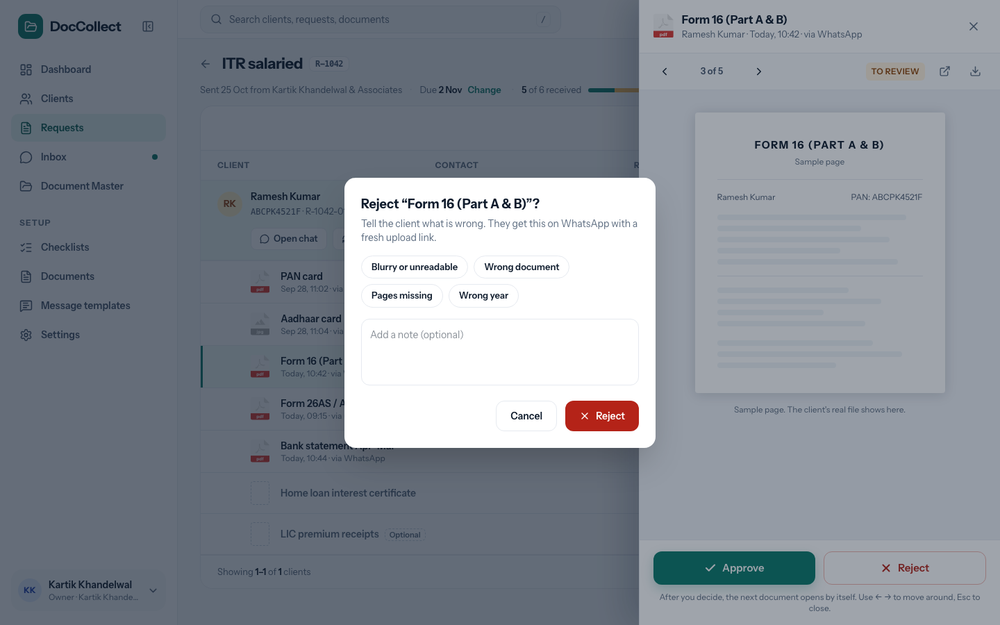

*Figure: Sending a document back.*

| Element | What it is |
|---|---|
| **Reasons** | Four buttons: **Blurry or unreadable**, **Wrong document**, **Pages missing**, **Wrong year**. One can be chosen. |
| **Add a note (optional)** | A box for the firm's own words. |
| **Cancel** | Closes. Nothing changes. |
| **Reject** | Sends the document back. |

| What the user chose | The client gets |
|---|---|
| A reason, a note, or both | **Document rejected**: "we could not accept <document>", with the reason and the note, and the client's upload link. |
| Nothing | **Document rejected** with "please send it again". |
| The document is optional | **Optional document rejected**: thanks for sending it, we could not use it, it is optional, send it again only if you would like, or skip it. |

| After Reject | What the user sees |
|---|---|
| WhatsApp is ready | The status becomes **Rejected**. The screen says "<document> rejected. The client was told on WhatsApp." |
| WhatsApp is not connected, or that message is not approved | The status becomes **Rejected**. The screen says "<document> rejected. The client was not told, because that message cannot be sent now. See Settings, under WhatsApp." |
| The client's number is not on WhatsApp | The status becomes **Rejected**. The screen says the client was not told, and why. |

## Looking at a file

A click on a file opens a preview with the file on one side, and the client, the document, the status, where it came from and when on the other, with the buttons **Approve** and **Send back**.

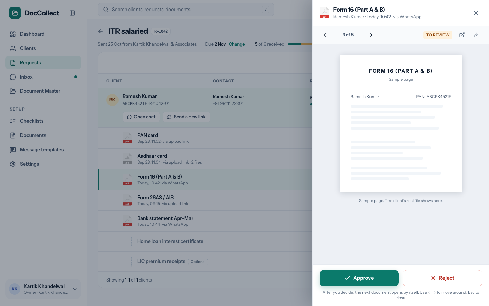

*Figure: The file preview.*

| Control | What it does |
|---|---|
| **Next and previous arrows** (and the left and right keys) | Move to the next or previous file waiting for review. |
| **A chip for each file** | Shows that file when a document has several. |
| **Approve** | Opens the approve window. |
| **Send back** | Asks for a reason in the same window, then rejects. |
| **Download** | For a file that cannot be shown here (Excel, Word, ZIP, HEIC). The firm looks at it and still approves or rejects in the app. |
| **Open in new tab** (the icon at the top right) | Opens the file on a page of its own, in a new browser tab. The page shows the file, its name, the client and where it came from, a **Download** button, and, for a document with several files, the list of files. It needs no sidebar. |
| **Close, or Esc** | Closes the preview. |

If a file is on the wrong document, the preview shows the request's checklist. The item the file is on says **This file**.

- The user picks another item, which says **Move here**, or **Swap** if that item already has a file, or the choice to take it off the checklist.
- A question follows: "Move this file to <document>?" or "Take this file off the checklist?", with **Cancel** and a confirm button.

## Reminding clients

**Remind** on a client, or **Remind N clients** at the top, opens a window.

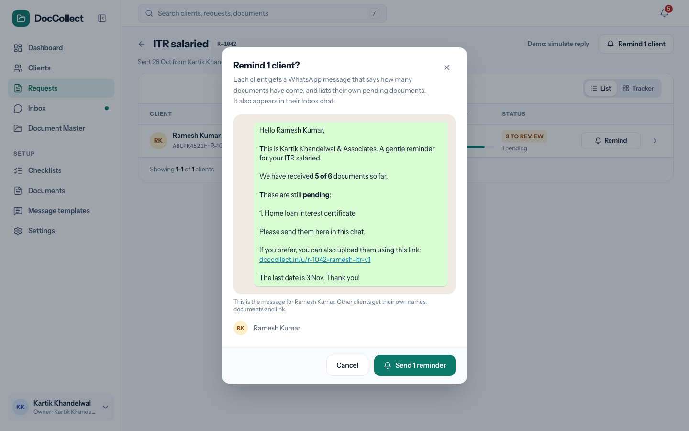

*Figure: Reminding a client.*

The window says "Each client gets a WhatsApp message that says how many documents have come, and lists their own pending documents. It also appears in their Inbox chat." It shows the exact message for the first client, the line "This is the message for <name>. Other clients get their own names, documents and link.", and the client names. The buttons are **Cancel** and **Send N reminders**.

For **Send update** the window says "Each client gets a WhatsApp message that says their documents are in. It also appears in their Inbox chat." and the button says **Send N updates**.

The firm does not choose the message.

| The client's situation | Message |
|---|---|
| Something is still missing: a document is pending, or was sent back | **Gentle reminder**. It says how many documents have come, for example "We have received 2 of 10 documents so far", lists what is still pending, and gives the last date. When nothing has come yet it says "0 of 10". |
| Every required document has arrived and some are still waiting for review | **All documents received**: "Thank you, we have received all your documents for your <request>. We are reviewing them and will let you know if anything else is needed." The button says **Send update**. |
| Every required document is approved | **All documents approved**: "All your documents for your <request> are approved. No more documents are needed from you. Thank you." The button says **Send update**. |

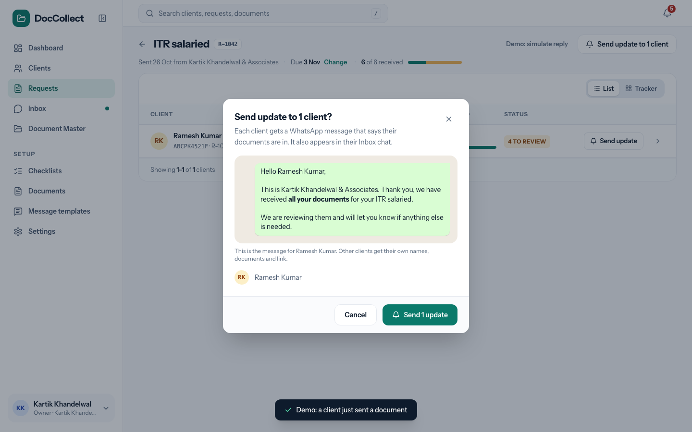

*Figure: Sending an update to a client whose documents have all arrived.*

The same two messages also go by themselves: **All documents received** when the last required document of a client arrives, and **All documents approved** when the last one is approved. **Send update** is the firm's way to send them again, or to send them when WhatsApp was not ready at that time.

A document counts as **arrived** when a file was received for it, whether it is waiting for review or approved. A document that is pending, or was sent back, counts as not arrived. An optional document that never came is not counted and not listed. An optional document that was sent back is listed as "(optional)".

| After sending | What the user sees |
|---|---|
| Sent | "Reminder sent to <client name> on WhatsApp", or, for example, "Reminder sent to 4 clients on WhatsApp". The client's "last reminded" date and time change, and the message is also in the chat. |
| Some numbers are not on WhatsApp | "Reminder sent to 3. Could not send to <names>: not on WhatsApp." |
| One client, not on WhatsApp | "Could not send to <name>: Not on WhatsApp". The row shows a red **Not on WhatsApp**, and the Inbox chat shows "Not delivered: Not on WhatsApp" under the message. It is not counted as reminded. |
| WhatsApp is not ready | The dialog for that situation opens. Nothing is sent. |

## The last date, and a new link

**Change** next to the date opens "Change the last date": "Clients see the new date on their upload page. The link stays the same and moves with the date." The buttons are **Cancel** and **Save**. After **Save**, the screen says "Last date is now <date>". Late and Overdue are worked out again. No message goes to the clients.

**Send a new link** in an opened row asks "Send a new link to <client>?" and says "They get a fresh link on WhatsApp. The old link stops working. Files they have already uploaded are kept." The buttons are **Cancel** and **Send new link**.

- The **Fresh upload link** message goes to the client, and the screen says "New link sent to <client> on WhatsApp".
- If the link has expired, the button is red.
- If the number is not on WhatsApp, or the firm cannot send, the link is not renewed.

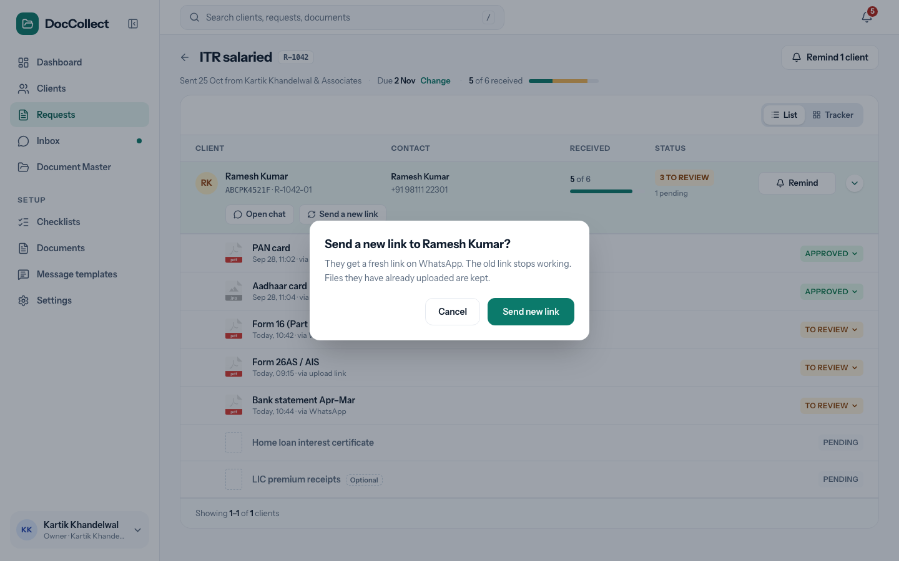

*Figure: Sending a new link.*

## The request as a Tracker

The switch **Tracker** shows the same request as a grid, with a client in each row and a document in each column. The client column shows the name, the PAN and the client's status.

- Each document column shows the name and a count such as "1 / 1", which is how many clients sent it out of how many were asked, and "optional" under an optional document.
- Each cell has a dot, as described in How Screens Behave.
- A click on a column heading sorts the clients by that document, with the missing ones first.
- A click on a dot that has a file opens the file preview.

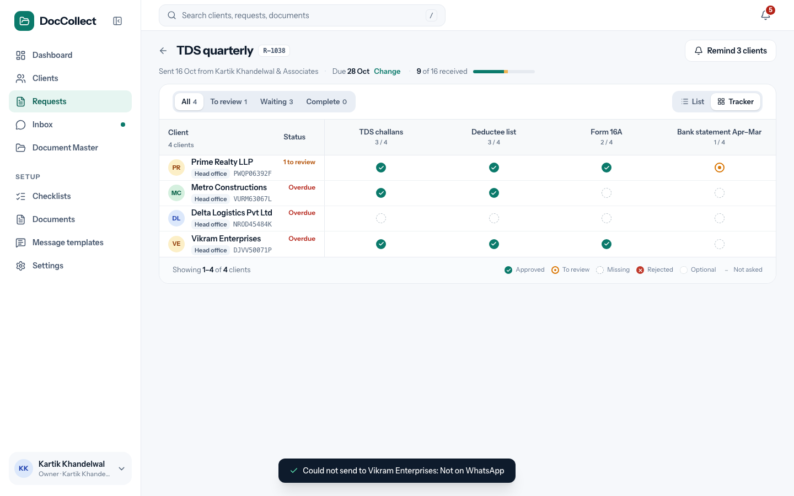

*Figure: The request as a Tracker.*

## What each click does

This table lists every control on the screen, where it is, and what happens when the user clicks it.

| Where | Click | What happens |
|---|---|---|
| Requests list | **New request** | Opens New Request. |
|  | A tab, **Last date**, the search box | Narrow the list at once. |
|  | A row | Opens the request page. |
|  | The arrow at the left of a row | Opens or closes the first five clients of the request. |
| Request page | The back arrow | Goes back to the Requests list. |
|  | **Change** next to the date | Opens the last date window. |
|  | **Remind N clients** or **Send update to N clients** | Opens the remind window. |
|  | **List** and **Tracker** | Switch how the clients are shown. |
|  | A column heading | Sorts the rows. A second click reverses the order. |
|  | A client's name | Opens the client page. |
|  | A row or its arrow | Opens or closes the client's documents. |
|  | **Remind** or **Send update** on a row | Opens the remind window for that client. |
| An opened row | **Open chat** | Opens the Inbox on this client's chat. |
|  | **Send a new link** | Opens the new link window. |
|  | A document's name or file | Opens the file preview. |
|  | The status button | Opens the status menu. |
| Status menu | **Approved** | Opens the approve window. |
|  | **Rejected** | Opens the reject window. |
|  | **To review** | Sets the status back at once. No message is sent. |

# Inbox

## Purpose

The Inbox shows every chat on the firm's connected WhatsApp number. It is a work number, so every message, photo and file comes in. It is the place where files that clients send in the chat are read, mapped and handled.

Files from saved clients are read and put on the client's request when they fit.

- Files from a number the firm has not saved are taken too: they wait in **Unassigned**, with a guess of the client from what is written on the file.
- The firm always makes the final decision.
- The rules for how a file is mapped are in How Files Are Read and Mapped.

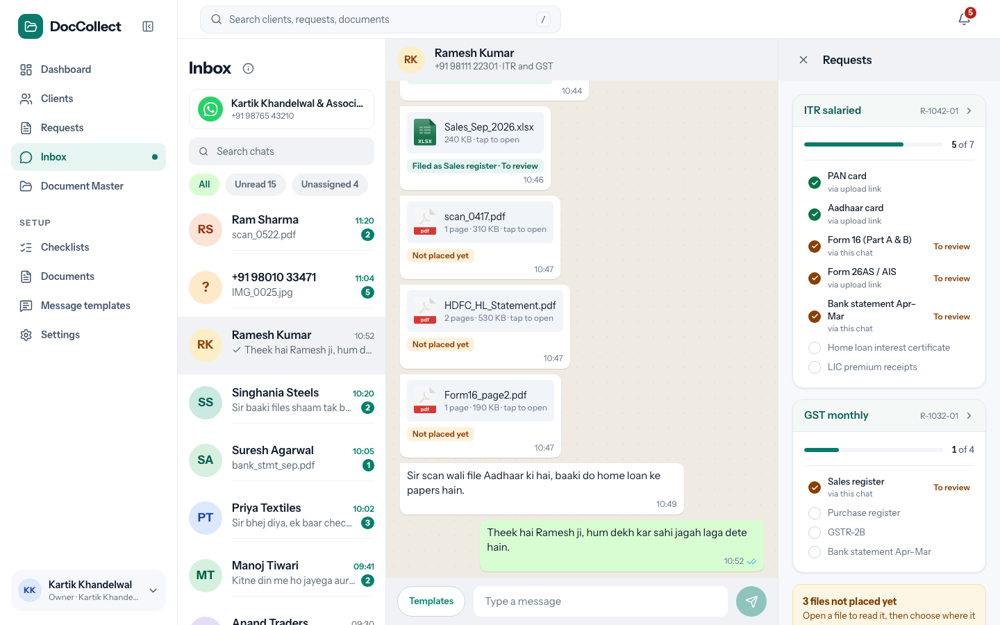

*Figure: The Inbox.*

## Where it fits in the flow

The Inbox is step 5 and step 6 of the journey, seen from the chat side: the client answers, and the file arrives as **To review**. The same files also show in the request. The Inbox is where files that could not be placed by themselves are handled.

## What the user sees

The screen has three areas and a box at the bottom: the chat list on the left, the chat in the middle, the **Requests** panel on the right, and the box to type at the bottom of the chat.

### The chat list (left)

| Element | What it shows |
|---|---|
| **Title and i icon** | The title **Inbox**. The **i** opens a note that says "Every chat on your number comes here, with its messages, photos and files. Files that look like documents are read and added to the client's request." |
| **Number card** | The firm's WhatsApp name and number, or "Not connected". |
| **Search box** | "Search chats". |
| **Filters** | **All**, **Unread** (with a count), **Unassigned** (with a count). |
| **A chat** | The avatar (initials, or a **?** for a number we do not know), the client's name (or the number), the last message or file name, the time, and a green count of new messages. |

### Filters and search

The three filters and the search box work together. **All** shows every chat.

- **Unread** shows only the chats with new messages, and says "You have read every chat." when there are none.
- **Unassigned** shows the chats from numbers the firm has not saved.
- The search box finds a chat by the client's name or by the number, and says "No client found." with "Try a name or a number." when nothing matches.
- A click on a chat opens it, and its count of new messages goes to zero.

### The chat (middle)

| Element | What it shows |
|---|---|
| **Header** | The client's name, the number and the kind of work ("ITR and GST"). For an unknown number it says **Tap to save contact**. |
| **Day lines** | **Today**, **Yesterday**, a weekday or a date. |
| **Messages from the client** | White bubbles on the left, with the time. |
| **Messages from the firm** | Green bubbles on the right, with the time and ticks. One grey tick means sent, two grey ticks mean delivered, and two blue ticks mean the client has read it. Every message the app sends, such as a request, a reminder or a new link, also shows here. |
| **A file** | A card with the file icon, name and size. A click opens the preview. |
| **A line under a file** | What happened to it: "Filed as Sales register · To review", "Not placed yet" (amber), or "Saved in Document Master". |
| **A line "what we read"** | A green line with what was read from the file, for example "PAN card of <client name>". |
| **A red line** | "Not delivered: Not on WhatsApp", under a message that the client could not get. |
| **A yellow card** | "Looks like <document>" with **Place it** and **Not this**. |

### The Requests panel (right)

The panel shows the open requests of this client, each with its progress, "5 of 7", and its documents, marked with a green tick (approved), amber (to review) or empty (pending), and where each came from, "via this chat" or "via upload link". A click on a request opens it, and a click on a document that has a file opens the preview. A box says "3 files not placed yet. Open a file to read it, then choose where it goes." When the client has no open request, the panel says "No open requests", "<client> has nothing asked for right now. Send a request to ask for documents.", with a button **New request**.

### When there are no chats

A firm with WhatsApp connected sees "When you send a request, or a client writes to you, the chat shows here. Files a client sends are read and placed for you." A firm without WhatsApp sees "Chats from your clients show here. Connect your WhatsApp to read their replies, or send a request first."

## How a file is handled

The firm never has to ask the client. What is written on the file, such as a PAN, a GSTIN or a name, decides the client. The sender's number is only a hint.

| What happens | What the firm sees |
|---|---|
| **A sure match.** The client is known, a request is open, and the file fits one pending document. | The file is put on that document by itself, as **To review**. The firm still approves it. |
| **Not sure.** Only the name matched, or the file fits more than one place. | A yellow card says "Looks like <document>", with the client, the kind of work, the request and how we know. The buttons are **Place it** and **Not this**. Nothing is filed until the firm chooses. |
| **No request.** The client is known but has no open request. | The file waits as **Not placed yet**. In the preview the firm chooses **Add to a request…** or **Save in a folder…**. |
| **The same document again.** | A line says "The same document was already sent before. It may be a duplicate." |
| **It looks like another client's.** | An amber line says "This file looks like <client>'s … not <chat>'s. Check before adding it." |
| **Not a document**, such as a photo. | It is skipped, with a note in the chat. Nothing is saved. |

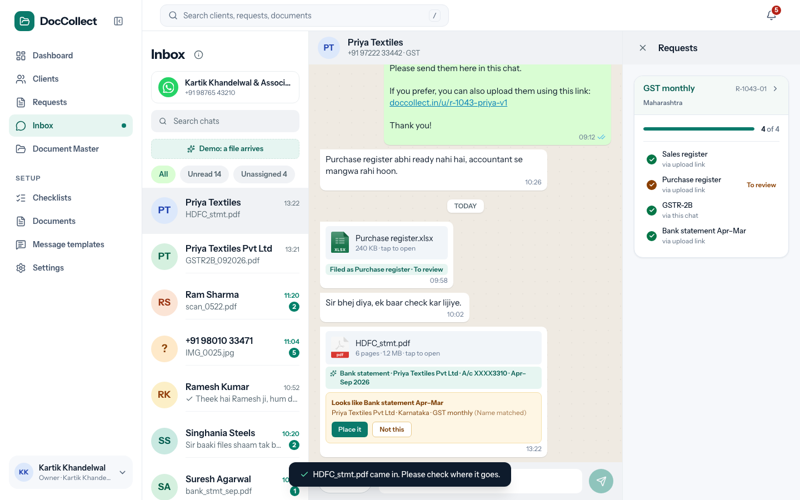

*Figure: A file that the product is not sure about.*

**Place it** puts the file on that document as **To review**, and the card becomes a green line. **Not this** drops the guess, and the file stays **Not placed yet**.

- **Add to a request…** asks for the request, when there are several, and then the document, and the file goes on it as **To review**; the screen says "<file> added to <document>".
- **Save in a folder…** opens the window "Save to Document Master", with the suggested folder already chosen, the line "Save in:", **New folder**, **Save here** and **Cancel**.

The preview of a file that is on a document has **Approve** and **Send back**, the same as in a request. **Send back** asks "Why is it being rejected?", with the four reasons and a box "Add a note for the client (optional)", and says "The client is told on WhatsApp." The firm can also move a wrongly placed file to another document, or take it off the checklist, as described in Requests.

## Files from numbers we do not know

A chat from an unknown number is called **Unassigned**, and a file from it is never filed by itself, because the number is not proven. The right panel says **Save these files**, with "5 files to save. Open a file to read it, then choose where it goes."

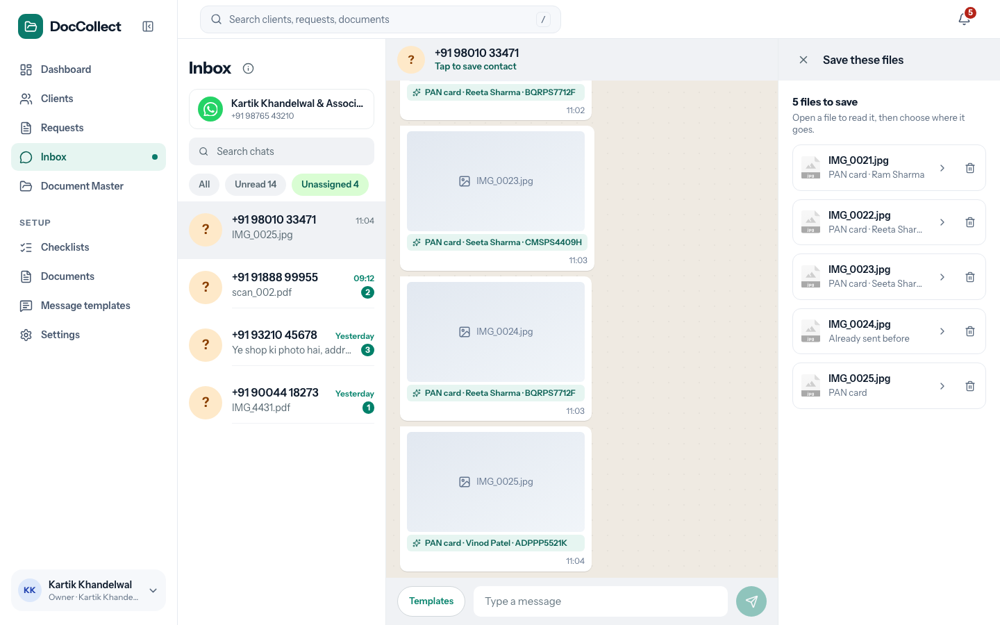

*Figure: An Unassigned chat.*

| Element | What it shows or does |
|---|---|
| **A file row** | The file name and a line such as "PAN card · Ram Sharma", which is what we read and our guess. "Already sent before" when it was sent before. |
| **Arrow** | Opens the file. |
| **Bin icon** | "Not a document, remove it". Removes the file from the list. |

The preview says at the bottom "For <client>" when the PAN matched, "We think this is <client>" with an amber **Check client** when only the name matched, or "We could not tell whose file this is. Save it in a folder, or save the number as a contact first." The buttons are **Add to a request…** and **Save in a folder…**. A search box, "Type a name or PAN to find another client", picks another client when the guess is wrong, and says "No client found." when nothing matches.

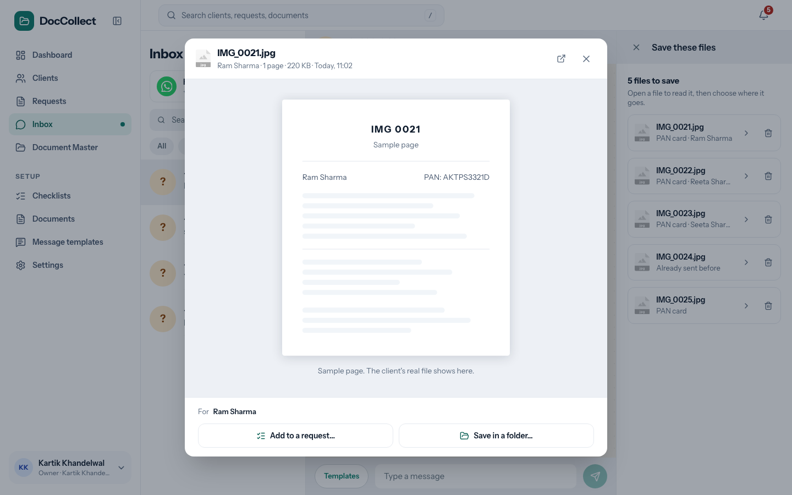

*Figure: A file from an unknown number.*

### Save the number as a contact

A click on the number at the top of the chat ("Tap to save contact"), or on "Save this number as a contact", opens the window **Save contact**.

| Field | What it is |
|---|---|
| **Name** | The person's name. The hint says "For example, Ram's wife". |
| **Associate with client** | A search box, "Type a name or PAN to find another client". The firm picks the client. |
| **Save contact** | Saves it. |

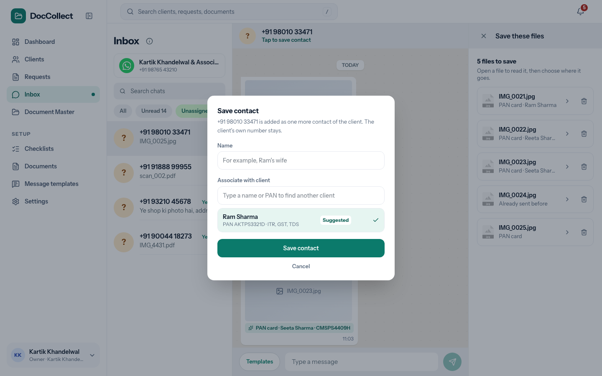

*Figure: Saving an unknown number as a contact.*

After **Save contact**, the number becomes an extra contact of that client, and the client's own number stays. The chat stops being Unassigned and becomes that client's chat. Files that were still waiting stay in it, marked **Not placed yet**. Later files from the number land in that client's chat.

## Typing and templates

What the firm can type depends on Meta's WhatsApp guidelines. The product sends a message whenever it is allowed, and follows the limit when a guideline puts one. At present the limit is the 24-hour window after the client's last message:

| Time since the client's last message | What the firm can do |
|---|---|
| **Within 24 hours** | Type any message. Enter sends it, and Shift+Enter starts a new line. **Templates** lists the approved messages. A click puts the message in the box, with the client's name filled in, and the firm can change it before sending. |
| **After 24 hours** | WhatsApp does not allow free typing. A note appears above the box: "It has been more than 24 hours since this client wrote. WhatsApp only allows approved templates now. Pick one with Templates. When the client replies, you can type again." The box is locked and says "24 hours passed. Use a template." |

After 24 hours, **Templates** lists only the approved messages that need nothing but the client's name, the firm name and the link.

- A click sends the message at once, as it is, and the screen says "<name> sent".
- A message that lists documents is not offered here; for that the firm uses **Remind** on the request.
- When there is no such message, the list says "No ready message fits here. To remind about documents, use Remind on the request." When the client writes again, typing opens for another 24 hours.

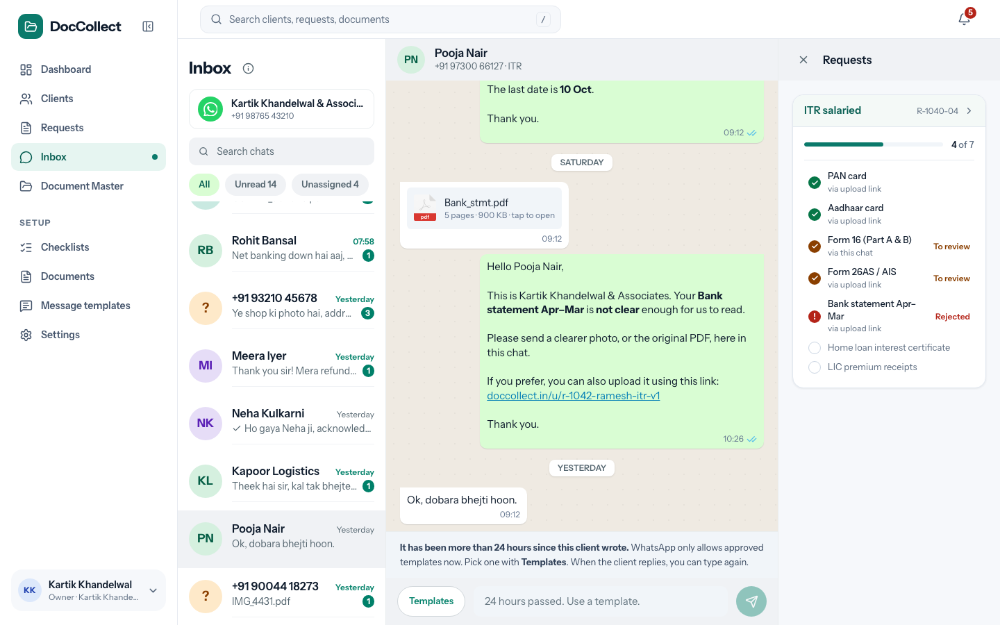

*Figure: A chat after 24 hours.*

The **Templates** list shows only messages that WhatsApp has approved. When none is approved it says "No message is approved by WhatsApp yet." When the firm's WhatsApp is not connected, the chats can still be read, but the box and **Templates** are locked, and a yellow bar offers **Connect WhatsApp**.

## What each click does

This table lists every control on the screen, where it is, and what happens when the user clicks it.

| Where | Click | What happens |
|---|---|---|
| Chat list | A chat | Opens it. Its count of new messages goes to zero. |
|  | **All**, **Unread**, **Unassigned** | Filter the list at once. |
|  | The **i** beside the title | Opens the note about what the Inbox keeps. |
| Chat | A file card | Opens the file preview. |
|  | **Place it** or **Not this** | Puts the file on the suggested document, or drops the suggestion. |
|  | The number at the top (unknown number) | Opens the window **Save contact**. |
| Requests panel | A request card | Opens the request page. |
|  | A document that has a file | Opens the file preview. |
|  | The box "N files not placed yet" | Opens the files one at a time, to choose where each goes. |
|  | **New request** | Opens New Request with this client ticked. |
| Bottom of the chat | **Templates** | Opens the list of approved messages. |
|  | A message in the list | Within 24 hours it goes into the box. After 24 hours it is sent at once. |
|  | The send arrow, or Enter | Sends the message. Shift+Enter starts a new line. |

# Document Master

## Purpose

Document Master is the firm's store of approved files, in folders. A switch at the top right has two views: **Folders**, which shows where each file is kept, and **Tracker**, which shows who has sent what. The choice is kept in the address, so a link can open the Tracker directly.

## Where it fits in the flow

This is step 8 of the journey: keep. A file arrives in Document Master when the firm approves it and chooses a folder (see Requests, "Approving a document"). The Tracker reads the same files and requests, so it is always in step with them.

## The Folders view

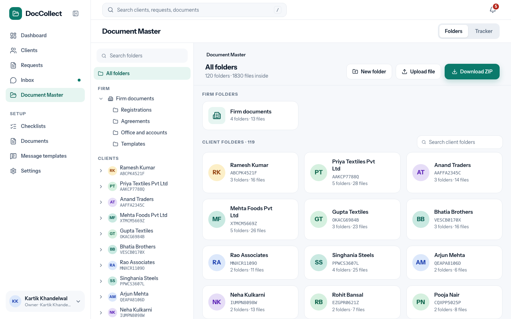

*Figure: Document Master, Folders view.*

### The folder tree (left)

| Element | What it shows |
|---|---|
| **Search box** | "Search client folders". Finds a client by name, place or number. When nothing matches it says so. |
| **All folders** | The top of Document Master. |
| **FIRM** | The firm's own folders, such as Registrations, Agreements and Office and accounts. |
| **CLIENTS** | One entry for each client, with its PAN. A client opens like a dropdown. |
| **Inside a client** | One entry for each registration (ITR with the PAN, GST with the state, TDS with the place), then the **Permanent** folder and the **Archive**. |
| **Show more** | A long list shows the first few, for example eight registrations, then **Show more**. |

### The open folder (right)

| Element | What it shows or does |
|---|---|
| **Breadcrumb** | "Document Master › Firm documents". Each part can be clicked. |
| **Title and line** | The folder name and "4 folders · 13 files inside". |
| **Buttons** | **New folder**, **Upload file**, **Download ZIP**. |
| **Folders** | The folders inside, as cards with a name and "4 files". |
| **Files** | The files, as a grid or a list. A switch changes it. |
| **An empty folder** | "This folder is empty. Make a folder inside it, or add files. You can also drag files from your computer onto this page." |

### What each kind of folder is

| Folder | What it holds and what can be done |
|---|---|
| **The firm's own folders** | The firm's own papers. They can be created, renamed, moved and deleted. Deleting one does not delete the approved documents in it. |
| **A client folder** | Named after the client, so it cannot be renamed. |
| **A registration folder** | Comes from the client's data and shows its number. It cannot be renamed, moved or deleted. Files go in its year folders, such as FY 2025-26. |
| **Permanent** | Files of documents set as "Send only one time", such as PAN and Aadhaar. They have no year and count in every year of the Tracker. |
| **Archive** | Files of a document the firm deleted, so nothing is lost. |
| **Not in a folder yet** | Approved files that were not saved in a folder. They wait at the top and can be saved later. |

### Working with folders and files

| Control | What happens |
|---|---|
| **New folder** | Asks "Give the folder a name." and makes the folder inside the open one. A name that already exists is refused: "A folder with this name already exists here." |
| **Upload file** | Opens the computer's file picker. The files are added to the open folder, and a message says how many. |
| **Download ZIP** | Downloads the open folder with its files. |
| **⋯ on a folder or a file** (and a right click) | **Rename**, **Move**, **Delete**. Only what is allowed for that folder is offered. |
| **Rename** | A window with the name and **Save**. An empty name says "Give it a name." A client folder says "A client folder is named after the client, so it cannot be renamed." |
| **Move** | Shows the folder tree and says "Choose where it should go." A folder cannot be moved into itself. |
| **Delete a file** | "This file is removed from Document Master. The request it came from is not changed." |
| **Dragging** | A file or a folder dragged onto another folder moves it there. Files dragged in from the computer are added to the folder they are dropped on. |
| **A click on a file** | Opens the preview, which has the same **Open in new tab** icon, arrows and **Download** as in Requests. For a file that cannot be shown (Excel, Word, ZIP, HEIC) it shows a card with **Download**. The file's own name is always shown, not only the document it was matched to. |

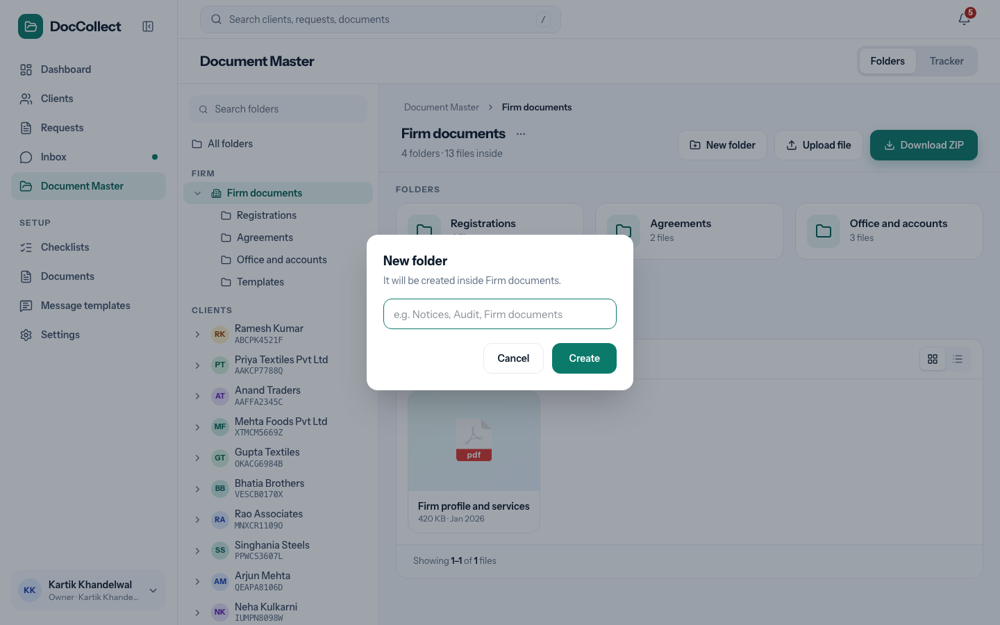

*Figure: Making a new folder.*

## The Tracker view

The Tracker answers one question: **who has sent what?** It is a grid with a client in each row and a document in each column.

*Figure: The Tracker.*

### Filters, search and sorting

The bar at the top has four filters, a search box and **Export**. The filters decide which clients and which documents the grid shows, and they work together.

| Filter | Choices and what they do |
|---|---|
| **Work** | **Income tax**, **GST** or **TDS**, each with its number of clients. It decides which clients are listed and which checklists can be chosen. |
| **Documents** | **From a checklist**: the user picks one checklist (for example "ITR salaried · 7"), and each of its documents becomes a column. If the checklist has no documents it says "This checklist has no documents" and "Add documents to the checklist in Checklists." **Choose documents**: the user ticks any documents ("Tick any documents. Each one becomes a column."), with a search box, "Search documents", and the line "Pick one or more documents, and you will see which clients have each of them." |
| **Year** | One financial year, or **All years**. Documents kept for good, such as PAN, count in every year. |
| **Clients** | **All**, **Complete**, **To review** and **Waiting for client**, each with its count. A client is counted by its one status. |
| **Search** | The client's name, place or number ("Search client, place or number"). |

When no client matches the filters, the grid says "No client matches these filters." A click on a heading sorts the grid: **Client** sorts by name, **Filing** sorts by how much is missing, and the heading of a document sorts the clients by that document, with the missing ones first. A second click reverses it. The grid shows 25, 50 or 100 clients on a page.

### The grid

| Part | What it shows |
|---|---|
| **Tick box** | One for each client. "Select all clients on this page" in the heading. |
| **Client** | The name and the PAN, with "119 registrations" under the heading. This column stays in view when the user scrolls sideways, with a soft shadow. |
| **Filing** | That client's one status: **to review** (with a number), **missing** (with a number) or **complete**. |
| **One column for each document** | The document name and a count such as "15 / 119": how many clients sent it out of how many were asked. An optional document says "optional". |

The dots in the cells mean the same as everywhere: a green tick is "the file is here and approved", orange is "the file came and is waiting for review", an empty circle is "waiting for client", a red cross is "sent back to the client, so it is still needed", a dashed circle is "asked only if the client has it, not counted as missing", and a dash is "this client does not need it". A key under the grid shows them. A click on a dot that has a file opens the file.

**One status for each client:** the Tracker gives each client one status, so a client never shows two. A client with files to review is **to review**, even if documents are also missing. A client with nothing to review but documents missing is **missing**. Otherwise the client is **complete**.

### Asking from the Tracker

The user ticks clients, and a bar appears at the bottom with the button **Ask for missing documents**. It opens a new request with those clients, and each client is asked only for what that client is missing.

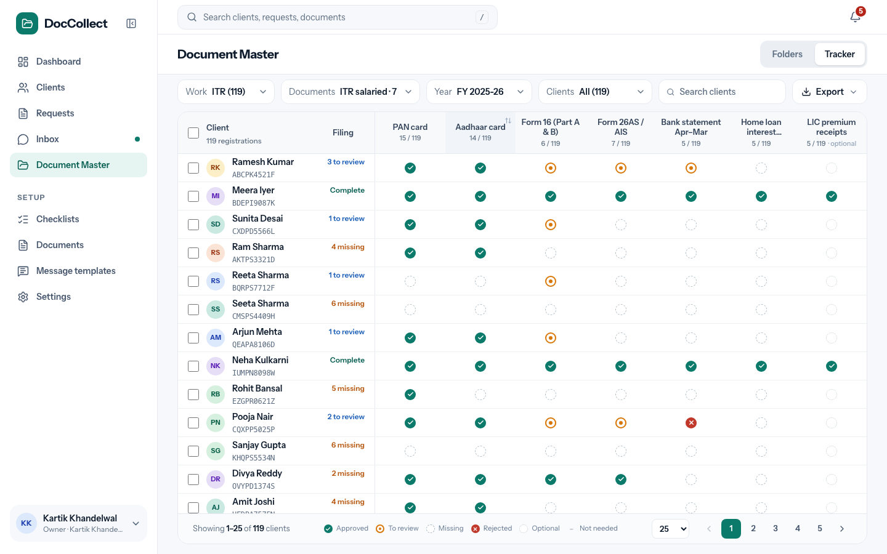

*Figure: Asking only for what is missing.*

| Case | What the user sees |
|---|---|
| The year is the current one, or **All years** | The button works. A number in brackets says how many of the ticked clients are missing something. |
| Another year | The bar says, for example, "Requests are made for FY 2025-26. Switch the year to ask." and the button is disabled. |
| Nothing is missing | The bar says "Nothing is missing for these clients." and the button is disabled. |

### Export

**Export** gives an **Excel** file or a **CSV**. In Excel the header row and the client column stay in view, every column has a filter, and the status cells are coloured. The CSV is plain text that opens in any tool. Only the clients that pass the filters are exported, in the order shown.

# Documents and Checklists

## Purpose

These two pages, under **Setup** in the left menu, hold the firm's list of documents and its saved checklists. The firm starts with a ready list and ready checklists, and can change them.

## Where it fits in the flow

This is step 3 of the journey: set up. A request is made from a checklist (see New Request), and each document in it carries the three settings described below.

## The Documents page

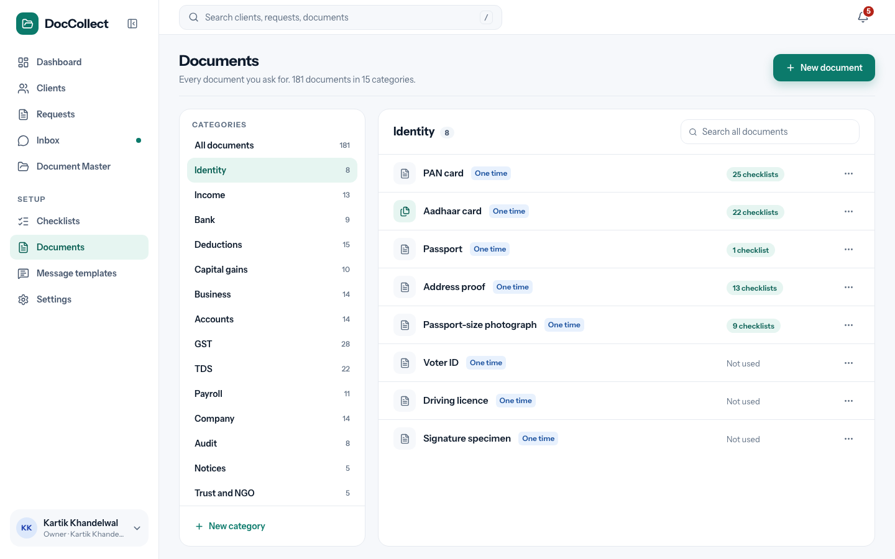

*Figure: The Documents page.*

The page says "Every document you ask for. 181 documents in 15 categories." The firm starts with this list.

| Element | What it shows or does |
|---|---|
| **Categories (left)** | Identity, Income, Bank, Deductions, Capital gains, Business, Accounts, GST, TDS, Payroll, Company, Audit, Notices, Trust and NGO, Foreign and NRI, each with its number of documents, and **All documents**. |
| **New category** | Opens a small window to name a category. |
| **Pencil beside a category** | Renames it. |
| **Bin beside a category** | Only a category with no documents has it. It asks first. |
| **Documents (right)** | The documents of the chosen category. Each row shows the name, tags for what is special (**One time**, **Optional**), how many checklists use it ("25 checklists", or "Not used"), and a **⋯** menu with **Edit** and **Delete**. |
| **Search box** | "Search all documents". Looks in all categories at once. When nothing matches the page says so. |

A category name that already exists is refused.

### New document and Edit document

**New document** opens a window that asks for a **Name** and a **Category**, and has three switches, all off at first.

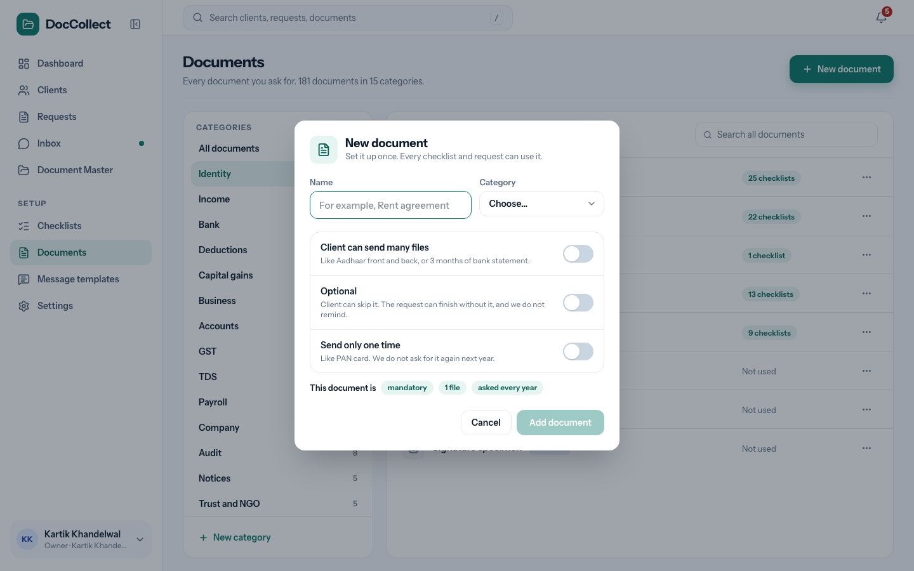

*Figure: The New document window.*

| Switch | What it says | What it does |
|---|---|---|
| **Client can send many files** | "Like Aadhaar front and back, or 3 months of bank statement." | A new file is added as one more file of the document. Without it, a new file replaces the old one. |
| **Optional** | "Client can skip it. The request can finish without it, and we do not remind." | The document never holds a request back, and nobody is reminded for it. |
| **Send only one time** | "Like PAN card. We do not ask for it again next year." | Its files have no year and are kept in the client's Permanent folder. |

A line under the switches sums up the choice: "This document is **mandatory**, **1 file**, **asked every year**." The button **Add document** is enabled when the name and category are filled.

- **Edit** opens the same window.
- If the user changes the name of a document that checklists use, the window says how many checklists are affected.
- If the user changes **Send only one time** on a document that has files, a note says where the files will show.

### Deleting a document

**Delete** first says what will happen.

| Case | What happens |
|---|---|
| The document is not used | It is deleted after a question. |
| It is used in checklists | It is taken out of them. The window says how many. |
| It already has files | The window asks what to do: **Move and delete**, where the user picks another document and the files go there, or **Archive and delete**, where the files go to each client's Archive. Nothing is lost. |

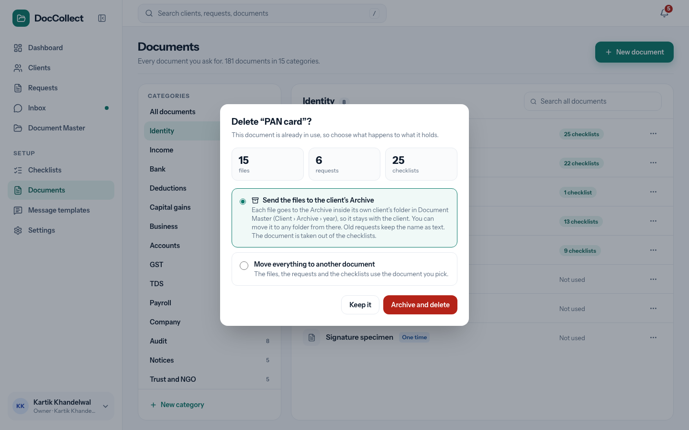

*Figure: Deleting a document that is in use.*

## The Checklists page

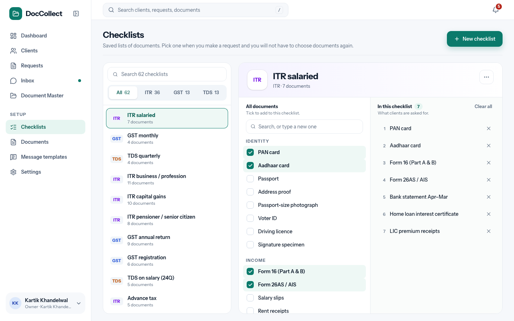

*Figure: The Checklists page.*

The page says "Saved lists of documents. Pick one when you make a request and you will not have to choose documents again." The firm starts with 62 checklists: 36 for Income tax, 13 for GST and 13 for TDS.

| Element | What it shows or does |
|---|---|
| **Left** | A search box, tabs **All**, **ITR**, **GST** and **TDS**, and the list of checklists, each with its kind and its number of documents. The search finds a checklist by its name. |
| **Right** | The chosen checklist, with two lists. |
| **All documents** | A tick box for each document, and a search box. Typing a name that does not exist adds it as a new document. |
| **In this checklist** | The chosen documents in order, with × to remove one, and **Clear all**, which empties the list at once and cannot be undone. |
| **⋯ menu** | A box to change the **Name** and **Used for** (Income tax, GST or TDS), and **Delete checklist**, which asks first. |
| **New checklist** | Starts an empty checklist. |

A checklist is always used for Income tax, GST or TDS. There is no "Other".

# Message Templates

## Purpose

Every message DocCollect sends to a client is a template: a fixed message that WhatsApp has approved. The firm cannot change the words. This page, under **Setup**, shows them, read only.

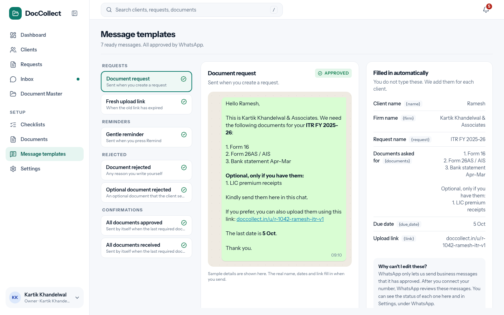

*Figure: The Message templates page.*

## Where it fits in the flow

Templates are used in steps 4, 6 and 7 of the journey: a request, a document sent back, and a reminder or an update. WhatsApp must approve each message before it can be sent from the firm's number, and they are sent for approval by themselves as soon as the firm's WhatsApp is connected and the channel id is received. The firm does nothing for it.

## What the user sees

| Area | What it shows |
|---|---|
| **Title and line** | **Message templates** and a line that depends on the state, below. |
| **Left** | The 7 messages in four groups: **Requests**, **Reminders**, **Rejected** and **Confirmations**. Each shows its name, a short line and a mark: a green tick for **Approved** or a clock for **Pending**. |
| **Middle** | The chosen message, with a badge and a sample as the client sees it. |
| **Right** | **Filled automatically**: "You do not type these. We add them for each client." It lists the values: client name, firm name, request name, documents, last date and link. **Why can't I edit these?** explains that WhatsApp only lets us send messages that it has approved. |

| State | The line under the title |
|---|---|
| All approved | "7 ready messages. All approved by WhatsApp." |
| Some approved | "7 ready messages. 6 approved by WhatsApp, the rest are waiting." |
| None approved yet | "7 ready messages. Waiting for WhatsApp to approve them." |
| WhatsApp not connected | "7 ready messages. Connect your WhatsApp and WhatsApp will review them." |

A message that WhatsApp has not approved shows as **Pending**, whether it is waiting or WhatsApp turned it down. The firm never sees names or reasons.

## When each message goes out

| Message | When it is sent |
|---|---|
| **Document request** | The firm presses **Send N messages** on a new request. One message for each client. |
| **Fresh upload link** | The firm presses **Send new link**. |
| **Gentle reminder** | The firm presses **Remind**. It goes to each client who still has a required document missing, pending or sent back. It says how many documents have come, and lists what is pending. |
| **All documents received** | It goes by itself, the moment the last required document of a client has arrived. The firm can also press **Send update** on a client whose required documents have all arrived. |
| **All documents approved** | It goes by itself, the moment the firm approves the last required document of a client. The firm can also press **Send update** on a client whose required documents are all approved. |
| **Document rejected** | The firm presses **Reject**. It carries the reason the firm chose and the firm's note, if there is one. |
| **Optional document rejected** | The firm presses **Reject** on an optional document. |

These seven are all the messages. Five go when the firm presses a button. Two go by themselves: **All documents received** and **All documents approved**. Both go once for a client, and only required documents count; an optional document never triggers them.

Approving any other document sends nothing. Every message that goes out is also written into the client's chat in the Inbox. The greeting uses the client's full name or the firm name, so it is clear when one phone gets messages for several people.

The file *Message-Templates.xlsx*, shared with this document, has the text of the 7 messages and the logic of when each goes out.

# Settings

## Purpose

Settings has four tabs: **Firm profile**, **WhatsApp**, **Upload links** and **Team**. The WhatsApp tab is described in the chapter on connecting WhatsApp.

## Where it fits in the flow

Settings is part of step 3, set up. What the firm enters here is used in every message and on the client's upload page.

## Firm profile

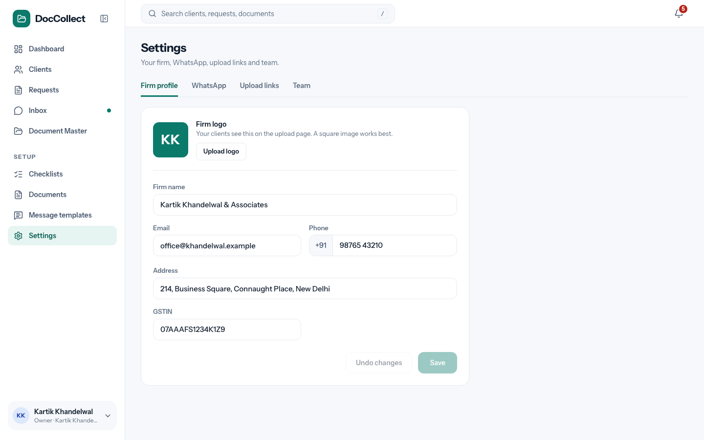

*Figure: The Firm profile tab.*

| Field | What it is | Rule |
|---|---|---|
| **Firm logo** | A box with the logo, or the firm's initials. The line says "Your clients see this on the upload page. A square image works best." The button is **Upload logo**. | An image. |
| **Firm name** | The firm's name. | Needed. |
| **Email** | The firm's email. | Free text. |
| **Phone** | +91 and 10 digits. | Needed, 10 digits. |
| **Address** | The firm's address. | Free text. |
| **GSTIN** | The firm's GSTIN. | GSTIN regex format. |

The firm name is used in every message ("This is <firm name>") and on the upload page. The phone number is shown to the client on the upload page.

- **Save** and **Undo changes** are grey until something changes.
- **Save** is disabled when the firm name is empty or the phone is not 10 digits.
- After **Save** the screen says "Firm details saved".
- **Undo changes** puts every field back to what was saved.

## Upload links

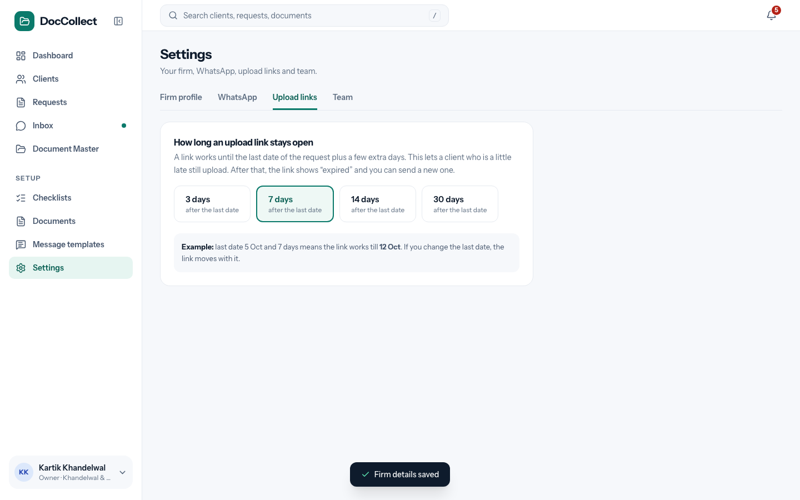

*Figure: The Upload links tab.*

The tab says "How long an upload link stays open." A link works until the request's last date plus a few extra days, so a client who is a little late can still upload.

- The user chooses **3 days**, **7 days** (the default), **14 days** or **30 days** after the last date.
- An example is shown: "last date 5 Oct and 7 days means the link works till 12 Oct. If you change the last date, the link moves with it." A click on a choice saves it at once, and every link follows it.
- After that, the link shows "expired", and the firm can send a new one.

## Team

The tab says "The people who work in this account." It is a plain list of each person's name, email and role: **Owner**, **Admin** or **Staff**. It is read only, and it only shows who is on the team. There is no role-based access: everyone can do everything. There is no invite and no delete in this version.

# Client Upload Page

## Purpose

This is what the client sees. It needs no login. The client opens it from the link in the WhatsApp message. Every request line has its own link, so a client with two GSTINs gets two pages.

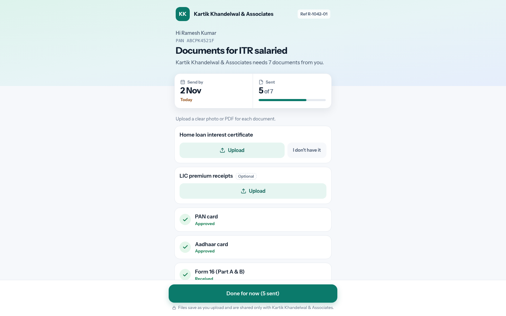

*Figure: The client's upload page.*

## Where it fits in the flow

This is step 5 of the journey: answer. A file uploaded here is already tied to a request line and a document, so it goes on that document as **To review** at once.

## What the client sees

| Element | What it shows |
|---|---|
| **Header** | The firm's logo and name, and the reference ("Ref R-1042-01"). |
| **Greeting** | "Hi <client name>" and the PAN. |
| **Title and line** | "Documents for ITR salaried" and "<Firm name> needs 7 documents from you." The count is of mandatory documents. |
| **Send by** | The last date. |
| **Sent** | "5 of 7" and a bar. |
| **Line** | "Upload a clear photo or PDF for each document." |
| **Cards** | One for each document, in this order: sent back first, then not sent yet, then already sent. |
| **Bottom button** | **Done for now (5 sent)**, or **Submit** when nothing is left. |
| **Lines at the bottom** | "Files save as you upload and are shared only with <firm name>." and "Questions? Call <the firm's phone>". |

### A card for each document

| State of the document | What the card shows |
|---|---|
| **Not sent yet** | The name, a button **Upload** and a button **I don't have it**. |
| **Optional** | A small tag **Optional** and only **Upload**. The client can skip it. There is no "I don't have it". |
| **Sent** | A green tick, **Received** and the file names, with **Replace** and **Remove**. **Remove** asks "Remove?" with **Yes** and **No**. A document that takes many files also has **Add another**. A document that takes one file is replaced by a new file. |
| **Approved** | A green tick and **Approved**. |
| **Sent back** | "Please send again: <the reason>" and the button **Upload again**. |
| **Not available** | "Marked as not available", with **Undo**. The firm sees "Client says this does not apply to them". |

### What each action does

| Action | What happens |
|---|---|
| **Upload** | Opens the camera or the file picker. The file is saved at once, and the card changes to **Received**. The bar and the count update. |
| **Upload again** | The same, for a document that was sent back. The status goes back to **To review** for the firm. |
| **I don't have it** | The card shows "Marked as not available". The firm can decide. |
| **Done for now** | Opens the thank-you page. |

## After "Done for now"

The page says "Thank you, <client name>. <Firm name> will check your documents. If anything is missing or unclear, you will get a message on WhatsApp." When something is still pending, a box says "1 document is still pending. You can open this link again until <date> to add it." and a button **Back to documents** returns to the cards. When every mandatory document is approved, the page says "All done" and "<Firm name> has approved all your documents. Thank you!"

## A link that does not work

| Case | What the client sees |
|---|---|
| The last date plus the extra days has passed | "This link has expired. Please ask <firm name> to send you a new link on WhatsApp." and the firm's phone number. |
| The link is wrong, or it is an old link after a new one was sent | "This link is not valid." and "It may have expired. Please ask <firm name> to send you a new one." |

The firm sends a new link from the request. When the firm changes the last date, the same link stays and works until the new date plus the extra days.

# Navigation and Search

## Purpose

This chapter describes the frame around every screen: the left menu, the top bar, the search, the bell and the account menu.

## The left menu

The left menu has **Dashboard**, **Clients**, **Requests**, **Inbox** and **Document Master**, and under **Setup**: **Checklists**, **Documents**, **Message templates** and **Settings**.

- A green dot on **Inbox** means something new.
- The menu can be collapsed with the arrow beside the DocCollect name, and then it shows only the icons.
- At the bottom is the signed-in user, who opens the account menu.

## Search

The search box at the top, "Search clients, requests, documents", finds clients by name, PAN, GSTIN, TAN or mobile number, requests, and documents.

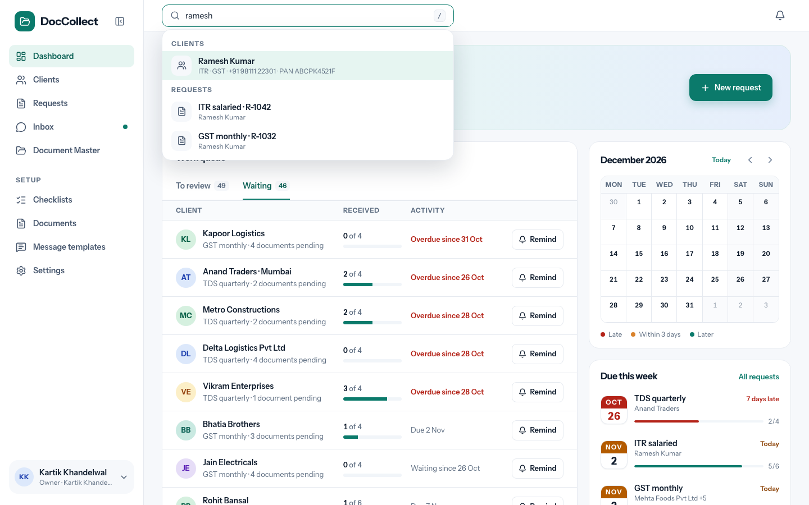

*Figure: Search results.*

| Control | What happens |
|---|---|
| **Typing** | Opens a list under the box with the matches in groups. When nothing matches, the list says so. |
| **A click on a match** | Opens it. |
| **The key /** | Moves the cursor to the search box. |

## The bell

The bell lists what needs attention: files that wait for review, files not placed yet, and late requests. A number on the bell says how many. Each item opens the screen where the work is done, for example the Inbox on the chat with the files.

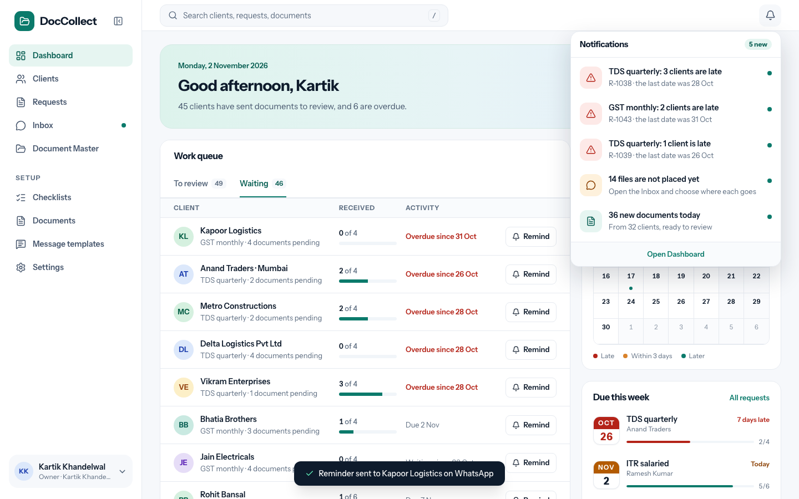

*Figure: The bell.*

## The account menu

The account menu has **Profile** and **Subscription**, which open KDK's own pages, and **Sign Out**, which shows the page "You have signed out".

